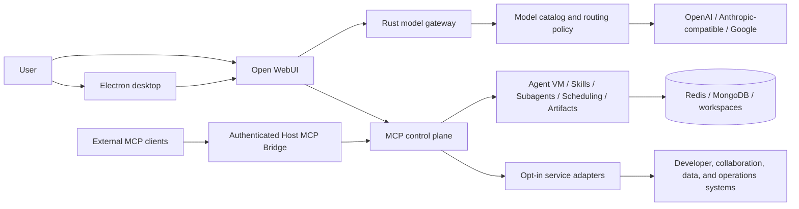

# Portico

** Design to be used by Engineers, and non engineers, with the AI First in Mind**

A local-first AI infrastructure **workbench** for assistants that can reason, use tools, execute work, and connect safely to real systems.

Portico brings a **desktop** chat surface, a multi-provider model gateway, an MCP control plane, isolated agent runtimes, reusable skills, and consent-aware tool execution into one developer environment. It is designed for the part of AI application engineering that begins after a model can answer a prompt: routing, authentication, tool discovery, runtime isolation, state, recovery, observability, and permission boundaries.

If you tweak this to be in your company or organization, the result is a system that can be connected to any of your MCPs and other platforms and available for everyone on a single place.
way.


## Architecture at a glance



The boundaries are deliberate:

1. The **model gateway** owns provider-specific request and response behavior.
2. The **MCP control plane** owns tool discovery, routing, health, auth, and
   lifecycle.
3. The **agent runtime** owns execution state, workspaces, skills, delegation,
   and scheduled work.
4. The **desktop layer** owns setup, consent, diagnostics, and the user-facing
   lifecycle.

This separation allows a provider, MCP server, or desktop client to change without requiring the rest of the system to be rewritten.

## Connections and integrations

Portico currently includes **28 MCP server definitions**, but you could connect any other or simply choose the MCPs you'd like

### Basic local profile

| Capability | What it enables |
| --- | --- |
| Agent VM | Persistent isolated containers, Bash and Python execution, workspace file operations, and skill scripts |
| Artifacts | Versioned web artifacts, live previews, restore points, and downloadable exports |
| MCP Assistant | Conversational installation, validation, update, removal, and restart of user-installed MCP servers |
| Scheduling | One-off and recurring agent tasks with integration preflight and durable tool scopes |
| Skills | Creation, activation, reference loading, and management of reusable agent instructions |
| Subagents | Delegated, parallel, hierarchical, and verification-oriented agent runs |
| Web Tools | Current web research with source citations |

### Opt-in adapters shipped in the repository

| Domain | Connections | Representative workflows |
| --- | --- | --- |
| Software delivery | GitLab, Sourcegraph, Chrome DevTools | Search code, inspect repositories, work with issues and merge requests, debug pages, trace network requests, and run browser checks |
| Collaboration and productivity | Slack, Google Workspace, Atlassian | Read or send messages, work with Docs/Slides/Sheets/Drive/Gmail/Calendar, and manage Jira or Confluence content |
| Data, automation, and operations | Snowflake, Datadog, Data Platform, n8n | Query data, inspect observability signals, investigate incidents, and create or execute automation workflows |
| Enterprise knowledge and operations | Glean, Ownership, Teamworks, Product Pal, Notifications, Trust Kit | Search organizational knowledge, resolve service ownership, inspect team structures, analyze feedback, work with notification campaigns, and support investigation workflows |
| Product and experience systems | Accessibility, Content Design, Design System, Proposal Builder | Validate accessibility, apply content and design guidance, discover components and tokens, and assemble structured proposals |

### Bring your own MCP server

The MCP Assistant can create and validate user-installed server definitions at runtime. Portico separates:

- **Docker servers** for network-accessible APIs and isolated tools.
- **Host servers** for capabilities that need the local filesystem, browser, or
  another host-level resource.
- **Core servers** that remain available while the regular and host MCP tiers
  restart.

That three-tier runtime allows an MCP integration to be installed or updated mid-session without tearing down the model gateway or losing the active chat. See the [MCP system architecture](docs/architecture/mcp/mcp-system.md) for the configuration and restart model.

### Use Portico from other MCP clients

The authenticated Host MCP Bridge exposes the active Portico toolbox through a single loopback Streamable HTTP endpoint. Supported clients receive separate bearer tokens and app-managed configuration; they do not need to understand the generated Docker topology or receive every tool schema in their context.

The bridge offers progressive tool and skill discovery: find only the relevant tools or skills, load the selected definitions, and dispatch a downstream call through Portico's existing auth and consent boundaries. Configuration adapters are included for multiple desktop and coding clients, including Cursor and Amp. See the [Host MCP Bridge guide](docs/MCPBridge.md) for the complete client and security contract.

## Safety and operational boundaries

Portico treats model access, tool access, execution, and user consent as separate decisions.

- External writes and destructive tools are classified and routed through a confirmation gate.
- Scheduled tasks persist an allowlist of approved MCP servers; using a new integration requires a new approval or an explicit scope update.
- OAuth-required tools are preflighted before unattended work is claimed.
- Credentials are read from local secret stores or runtime secret files rather than committed configuration.
- External MCP clients receive individual revocable bridge credentials.
- Service ports are bound to loopback or isolated container networks by default.
- The Docker socket is reached through a restricted proxy rather than mounted directly into general application containers.

The [tool-confirmation model](docs/security/tool-confirmation.md), [secret broker architecture](docs/architecture/auth/mcp-secret-broker.md), and [security hardening overview](docs/security/hardening-overview.md) document these boundaries in more detail.

## Implementation stack

| Layer | Main technologies | Responsibility |
| --- | --- | --- |
| Native control plane | Rust, Axum, Tokio | Model gateway, MCP orchestration, OAuth coordination, health aggregation, host bridge, and core MCP services |
| Desktop application | Electron, Node.js, JavaScript | Setup, process lifecycle, service controls, OS integration, Keychain access, consent UI, workspaces, artifacts, and diagnostics |
| Agent and chat services | Python, FastAPI/Open WebUI middleware | Context and skill injection, chat-state APIs, tool-call policy, event publishing, and debug services |
| Runtime infrastructure | Docker Compose, Redis, MongoDB, Nginx | Isolation, coordination, persistence, routing, health, and local service topology |
| Verification | Rust tests, Node test runner, Pytest, shell contract tests | Cross-boundary behavioral coverage for the gateway, desktop, MCP lifecycle, security, packaging, and runtime scripts |

## Run locally

The local development path is tested on macOS with Docker or OrbStack, Node.js, Rust, and Python. From a clean checkout, build the images and Electron dependencies:

```bash
./install_v2.sh --force-local-build --node --no-launch
```

### Configure a model provider

The upstream model credential is resolved from the `portico` macOS Keychain entry (`PORTICO_LLM_API_KEY`) or from an explicit installer environment value; it is not written to `.env`. Provider endpoints and catalog selection are local configuration:

```dotenv
LLM_PROXY_BASE_URL=https://your-provider-gateway.example/v1
PORTICO_MODEL_CATALOG_PATH=./model_catalog.local.yaml
```

Use the checked-in [`model_catalog.yaml`](model_catalog.yaml) as the public example. Put deployment-specific model IDs or private endpoints in `model_catalog.local.yaml`; that filename is gitignored. The Compose stack uses the public catalog when `PORTICO_MODEL_CATALOG_PATH` is unset.

The main loopback services are:

- Open WebUI: <http://localhost:3789>
- MCP control plane: <http://localhost:8765>
- MCP core control plane: <http://localhost:8766>
- Host MCP Bridge: <http://127.0.0.1:8891/mcp> when enabled

## Project status

The local developer and demonstration path is runnable. The repository is still being prepared for a public release: asset and dependency licensing, signing, governance, and the separation of remaining deployment-specific adapters must be completed before treating it as a generally distributable product. See [`docs/open-source-readiness.md`](docs/open-source-readiness.md) for that publication boundary.
