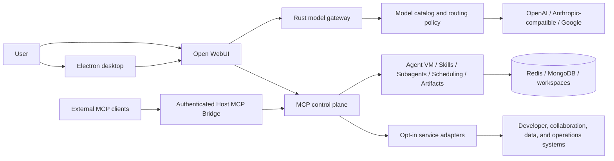

# Portico

**A local-first AI infrastructure workbench for assistants that can reason, use
tools, execute work, and connect safely to real systems.**

Portico brings a desktop chat surface, a multi-provider model gateway, an MCP
control plane, isolated agent runtimes, reusable skills, and consent-aware tool
execution into one developer environment. It is designed for the part of AI
application engineering that begins after a model can answer a prompt: routing,
authentication, tool discovery, runtime isolation, state, recovery,
observability, and permission boundaries.

The result is a system in which a user can ask for an outcome in natural
language, let the assistant discover the relevant capabilities, inspect or
change connected systems with explicit authorization, delegate longer work to
subagents, and retain the artifacts and operational evidence produced along the
way.

## What the system demonstrates

| Area | Implemented capability | Engineering concern |
| --- | --- | --- |
| Model runtime | Catalog-driven routing across OpenAI, Anthropic-compatible/Bedrock Converse, and Google/Gemini model families | Provider normalization, streaming, reasoning controls, prompt caching, tool-schema compaction, model migrations, and cost metadata |
| MCP control plane | Discovery, configuration generation, health checks, OAuth coordination, server lifecycle, and tool exposure across Docker and host runtimes | A stable boundary between chat sessions and heterogeneous tool servers |
| Agent execution | Persistent containerized Agent VMs, workspace file operations, ephemeral script execution, subagents, and scheduled runs | Isolation, long-running work, delegation, retries, and state continuity |
| Skills and agents | Built-in and user-authored `SKILL.md` packages, reference loading, activation, hot reload, and marketplace-style lifecycle support | Reusable agent behavior separated from application code and model choice |
| Consent and secrets | Destructive-tool confirmation, durable permission scopes for scheduled work, macOS Keychain integration, runtime secret files, and scoped OAuth token brokering | Human control over side effects without placing credentials in prompts or tracked configuration |
| Reliability | Service health aggregation, partial MCP restarts, auto-healing paths, chat-state persistence, diagnostics, and update rollback support | Recoverable local infrastructure instead of a collection of unmanaged subprocesses |
| Observability | Structured request tracing, MCP health and tool counts, debug monitoring, bridge telemetry, and per-chat cost reporting | Evidence for latency, routing, tool use, failures, and operational debugging |
| Desktop delivery | Electron application, guided setup, service controls, native notifications, artifact previews, workspace management, and a containerized Open WebUI surface | A usable operating layer over the model and tool infrastructure |

## Architecture at a glance



The boundaries are deliberate:

1. The **model gateway** owns provider-specific request and response behavior.
2. The **MCP control plane** owns tool discovery, routing, health, auth, and
   lifecycle.
3. The **agent runtime** owns execution state, workspaces, skills, delegation,
   and scheduled work.
4. The **desktop layer** owns setup, consent, diagnostics, and the user-facing
   lifecycle.

This separation allows a provider, MCP server, or desktop client to change
without requiring the rest of the system to be rewritten.

## Connections and integrations

Portico currently includes **28 MCP server definitions**. The Basic local
profile starts seven provider-neutral capabilities; the remaining adapters stay
off until their endpoint, credentials, and authorization are explicitly
configured.

### Basic local profile

| Capability | What it enables |
| --- | --- |
| Agent VM | Persistent isolated containers, Bash and Python execution, workspace file operations, and skill scripts |
| Artifacts | Versioned web artifacts, live previews, restore points, and downloadable exports |
| MCP Assistant | Conversational installation, validation, update, removal, and restart of user-installed MCP servers |
| Scheduling | One-off and recurring agent tasks with integration preflight and durable tool scopes |
| Skills | Creation, activation, reference loading, and management of reusable agent instructions |
| Subagents | Delegated, parallel, hierarchical, and verification-oriented agent runs |
| Web Tools | Current web research with source citations |

### Opt-in adapters shipped in the repository

| Domain | Connections | Representative workflows |
| --- | --- | --- |
| Software delivery | GitLab, Sourcegraph, Chrome DevTools | Search code, inspect repositories, work with issues and merge requests, debug pages, trace network requests, and run browser checks |
| Collaboration and productivity | Slack, Google Workspace, Atlassian | Read or send messages, work with Docs/Slides/Sheets/Drive/Gmail/Calendar, and manage Jira or Confluence content |
| Data, automation, and operations | Snowflake, Datadog, Data Platform, n8n | Query data, inspect observability signals, investigate incidents, and create or execute automation workflows |
| Enterprise knowledge and operations | Glean, Ownership, Teamworks, Product Pal, Notifications, Trust Kit | Search organizational knowledge, resolve service ownership, inspect team structures, analyze feedback, work with notification campaigns, and support investigation workflows |
| Product and experience systems | Accessibility, Content Design, Design System, Proposal Builder | Validate accessibility, apply content and design guidance, discover components and tokens, and assemble structured proposals |

An adapter definition represents an implemented configuration and lifecycle
boundary, not bundled access to a third-party or private service. Several
definitions are deployment-specific examples and require replacement endpoints
or organization authorization. They are disabled by default so a clean local
installation does not assume access it has not been given.

### Bring your own MCP server

The MCP Assistant can create and validate user-installed server definitions at
runtime. Portico separates:

- **Docker servers** for network-accessible APIs and isolated tools.
- **Host servers** for capabilities that need the local filesystem, browser, or
  another host-level resource.
- **Core servers** that remain available while the regular and host MCP tiers
  restart.

That three-tier runtime allows an MCP integration to be installed or updated
mid-session without tearing down the model gateway or losing the active chat.
See the [MCP system architecture](docs/architecture/mcp/mcp-system.md) for the
configuration and restart model.

### Use Portico from other MCP clients

The authenticated Host MCP Bridge exposes the active Portico toolbox through a
single loopback Streamable HTTP endpoint. Supported clients receive separate
bearer tokens and app-managed configuration; they do not need to understand the
generated Docker topology or receive every tool schema in their context.

The bridge offers progressive tool and skill discovery: find only the relevant
tools or skills, load the selected definitions, and dispatch a downstream call
through Portico's existing auth and consent boundaries. Configuration adapters
are included for multiple desktop and coding clients, including Cursor and Amp.
See the [Host MCP Bridge guide](docs/MCPBridge.md) for the complete client and
security contract.

## Example end-to-end workflows

With the relevant opt-in adapters configured, Portico can support workflows
that cross model, tool, and execution boundaries:

- **Engineering investigation:** search code and ownership metadata, inspect
  runtime telemetry, reproduce a failure in an Agent VM, produce an artifact,
  and prepare a tracked code or issue update for confirmation.
- **Knowledge-to-delivery workflow:** research internal documentation, draft a
  decision or project document, update Jira or Confluence, and publish a Slack
  summary after the user approves the write actions.
- **Data and automation workflow:** query Snowflake or another data platform,
  analyze the result in an isolated workspace, generate a visual artifact, and
  schedule a recurring subagent to repeat the workflow within a fixed tool
  scope.
- **Long-horizon implementation:** give a subagent a persistent workspace and
  skill set, delegate independent verification, retain produced files between
  turns, and surface failures or authorization needs back in the desktop UI.
- **Shared developer toolbox:** configure an external MCP client once, then use
  Portico's tool and skill catalog without duplicating every integration and
  credential across client applications.

## Safety and operational boundaries

Portico treats model access, tool access, execution, and user consent as
separate decisions.

- External writes and destructive tools are classified and routed through a
  confirmation gate.
- Scheduled tasks persist an allowlist of approved MCP servers; using a new
  integration requires a new approval or an explicit scope update.
- OAuth-required tools are preflighted before unattended work is claimed.
- Credentials are read from local secret stores or runtime secret files rather
  than committed configuration.
- External MCP clients receive individual revocable bridge credentials.
- Service ports are bound to loopback or isolated container networks by
  default.
- The Docker socket is reached through a restricted proxy rather than mounted
  directly into general application containers.

The [tool-confirmation model](docs/security/tool-confirmation.md), [secret broker
architecture](docs/architecture/auth/mcp-secret-broker.md), and [security
hardening overview](docs/security/hardening-overview.md) document these
boundaries in more detail.

## Implementation stack

| Layer | Main technologies | Responsibility |
| --- | --- | --- |
| Native control plane | Rust, Axum, Tokio | Model gateway, MCP orchestration, OAuth coordination, health aggregation, host bridge, and core MCP services |
| Desktop application | Electron, Node.js, JavaScript | Setup, process lifecycle, service controls, OS integration, Keychain access, consent UI, workspaces, artifacts, and diagnostics |
| Agent and chat services | Python, FastAPI/Open WebUI middleware | Context and skill injection, chat-state APIs, tool-call policy, event publishing, and debug services |
| Runtime infrastructure | Docker Compose, Redis, MongoDB, Nginx | Isolation, coordination, persistence, routing, health, and local service topology |
| Verification | Rust tests, Node test runner, Pytest, shell contract tests | Cross-boundary behavioral coverage for the gateway, desktop, MCP lifecycle, security, packaging, and runtime scripts |

## Run locally

The local development path is tested on macOS with Docker or OrbStack, Node.js,
Rust, and Python. From a clean checkout, build the images and Electron
dependencies:

```bash
./install_v2.sh --force-local-build --node --no-launch
```

Then launch Electron in the foreground:

```bash
cd electron-app
npm run bundle
npm run start
```

Choose **Basic local setup** on first launch. Stop the foreground app with
`Ctrl-C`.

Portico uses a local identity by default. OIDC is opt-in through
`PORTICO_IDENTITY_MODE=oidc` plus `SETUP_AUTH_ISSUER`; an incomplete OIDC
configuration fails closed.

### Configure a model provider

The upstream model credential is resolved from the `portico` macOS Keychain
entry (`PORTICO_LLM_API_KEY`) or from an explicit installer environment value;
it is not written to `.env`. Provider endpoints and catalog selection are local
configuration:

```dotenv
LLM_PROXY_BASE_URL=https://your-provider-gateway.example/v1
PORTICO_MODEL_CATALOG_PATH=./model_catalog.local.yaml
```

Use the checked-in [`model_catalog.yaml`](model_catalog.yaml) as the public
example. Put deployment-specific model IDs or private endpoints in
`model_catalog.local.yaml`; that filename is gitignored. The Compose stack uses
the public catalog when `PORTICO_MODEL_CATALOG_PATH` is unset.

The main loopback services are:

- Open WebUI: <http://localhost:3789>
- MCP control plane: <http://localhost:8765>
- MCP core control plane: <http://localhost:8766>
- Host MCP Bridge: <http://127.0.0.1:8891/mcp> when enabled

## Verification

Run the cross-language repository gate after source, configuration, packaging,
or runtime changes:

```bash
./run-tests.sh
```

Audit the live container and secret posture with:

```bash
./security-audit.sh
```

The current Basic-profile local path has been verified with all seven selected
MCP capabilities healthy and a real streamed model response through the
Electron application.

## Development and contribution

New integrations should be explicit adapters or user configuration rather than
hard-coded provider or organization defaults. Each integration should document
its authentication model, permissions, data handling, failure behavior, and
local test path.

Portico uses protected `develop` and `main` branches: feature and bug-fix pull
requests merge into `develop`, then a release pull request promotes `develop`
to `main`. See the [branching strategy](docs/development/branching-strategy.md)
for the enforced workflow.

Do not commit `.env` files, local model catalogs, generated Compose overrides,
runtime state, credentials, or local build output. The root `.gitignore`
protects the common cases, but review `git status` before every commit.

## Project status

The local developer and demonstration path is runnable. The repository is still
being prepared for a public release: asset and dependency licensing, signing,
governance, and the separation of remaining deployment-specific adapters must
be completed before treating it as a generally distributable product. See
[`docs/open-source-readiness.md`](docs/open-source-readiness.md) for that
publication boundary.
