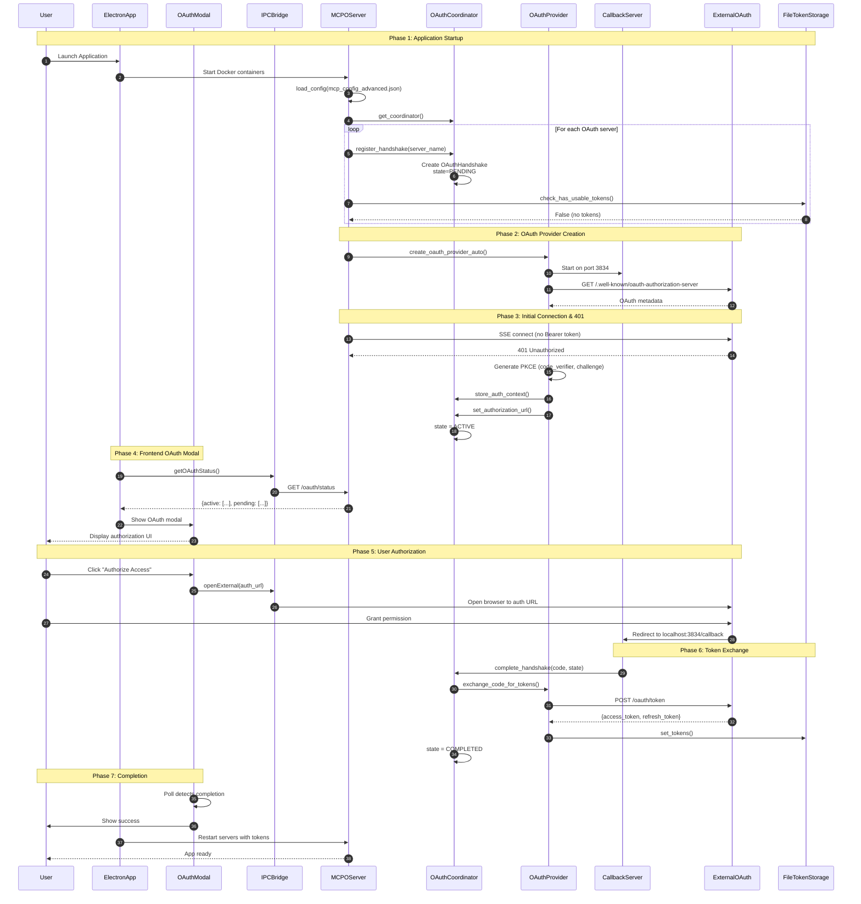
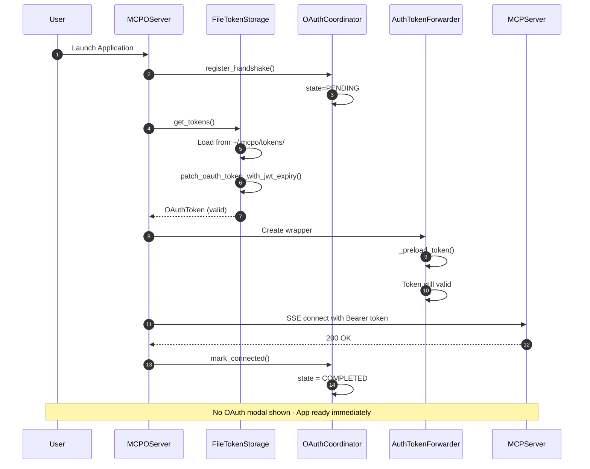
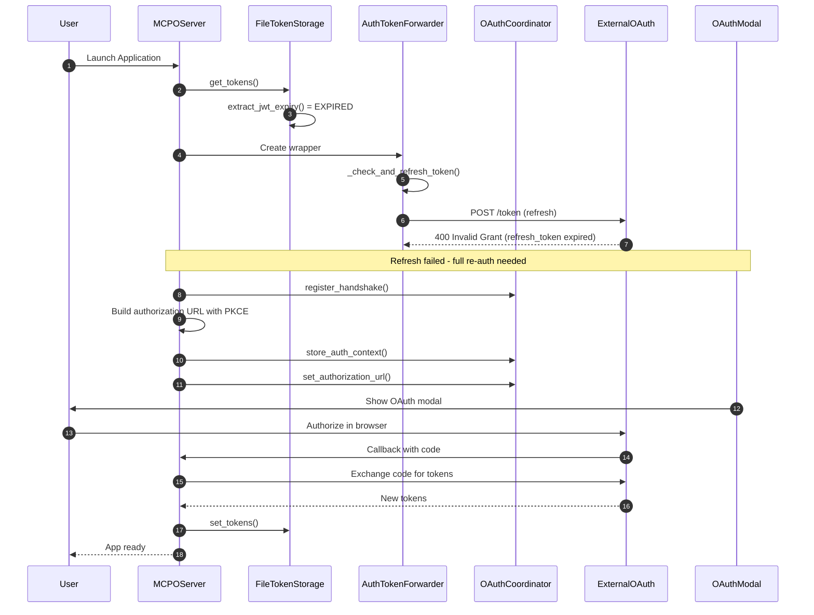
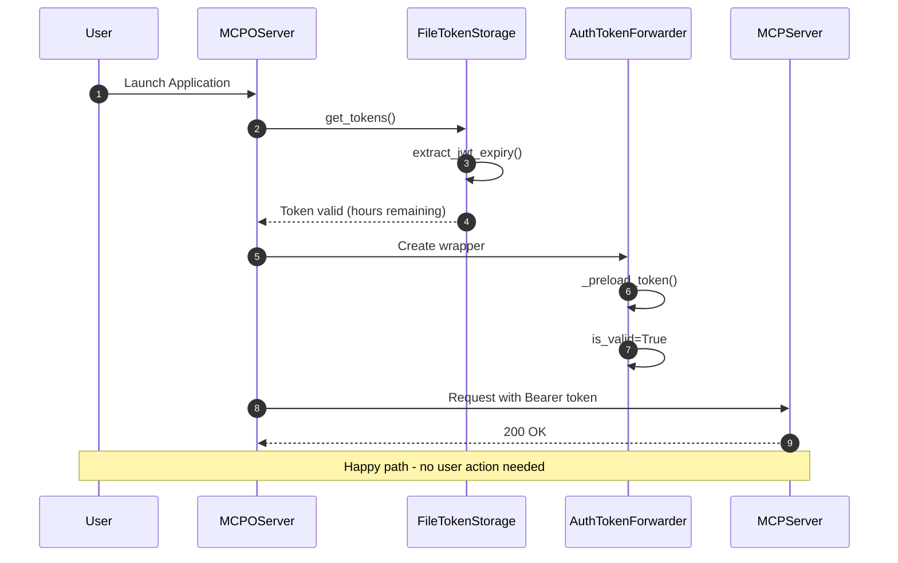
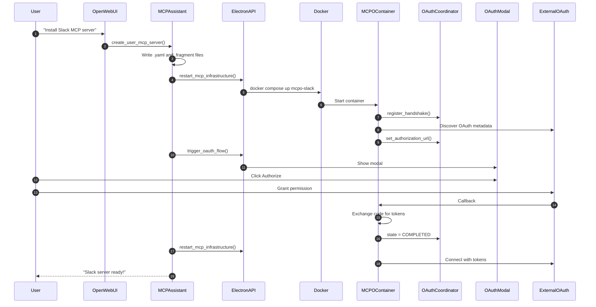
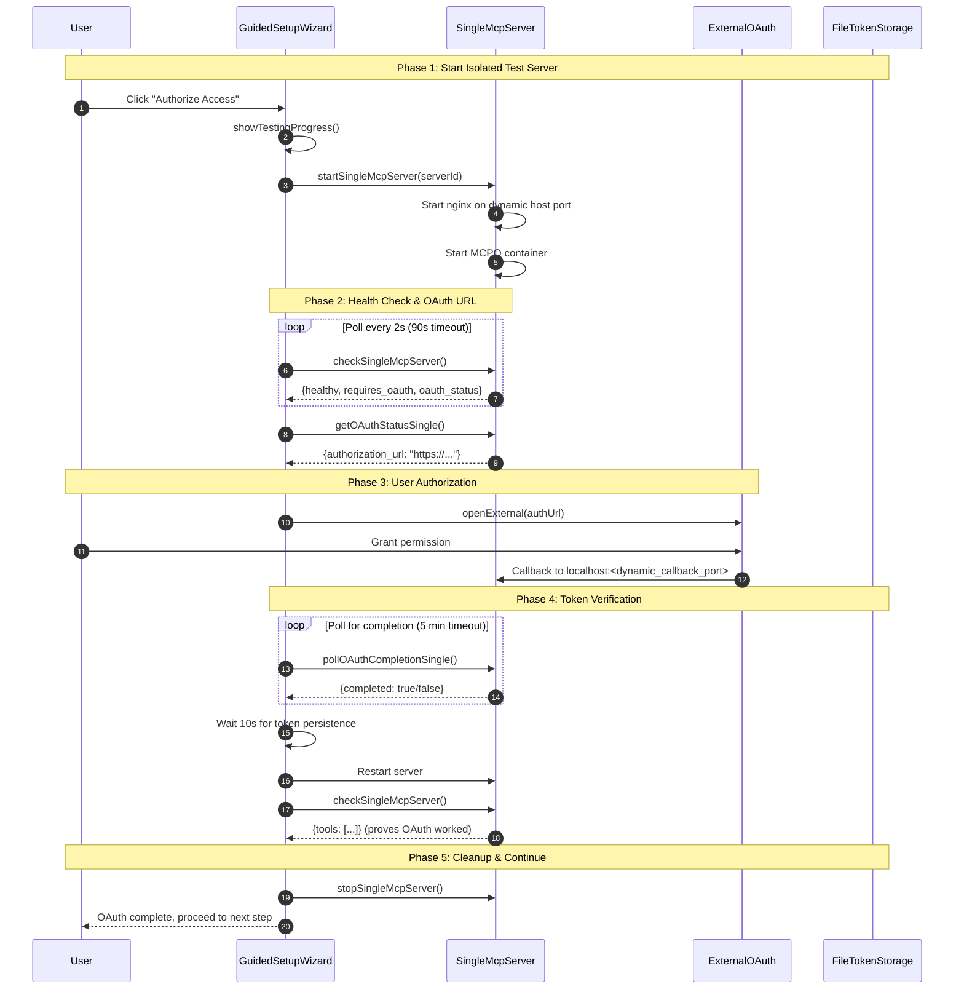

# OAuth Architecture Documentation

This document provides a comprehensive overview of the OAuth implementation in the Open WebUI MCP system, including architecture details, component descriptions, and sequence diagrams for all OAuth flows.

> **Broker-era note:** durable MCP OAuth records now live host-side in Electron `safeStorage`, and Docker MCP runtimes receive only scoped broker-vended runtime access-token material. This document still describes the end-to-end OAuth state machine and callback flow; for the host-side record store, scoped broker endpoints, legacy migration path, and first-time empty-safeStorage constraints, see [`mcp-secret-broker.md`](mcp-secret-broker.md).

## Table of Contents

1. [Architecture Overview](#architecture-overview)
2. [Key Components](#key-components)
3. [OAuth Flows](#oauth-flows)
   - [Flow 1: Fresh Install (No Cached Tokens)](#flow-1-fresh-install-no-cached-tokens)
   - [Flow 2: Restart with Cached Tokens (Valid)](#flow-2-restart-with-cached-tokens-valid)
   - [Flow 3: Expired Tokens (Several Weeks)](#flow-3-expired-tokens-several-weeks)
   - [Flow 4: Valid Tokens (Few Hours Old)](#flow-4-valid-tokens-few-hours-old)
   - [Flow 5: Install New OAuth MCP via Chat](#flow-5-install-new-oauth-mcp-via-chat)
   - [Flow 6: Guided Setup Wizard OAuth](#flow-6-guided-setup-wizard-oauth)
4. [State Machine](#state-machine)
5. [Callback Routing Architecture](#callback-routing-architecture)
6. [Token Storage](#token-storage)
7. [Troubleshooting](#troubleshooting)

---

## Architecture Overview

The OAuth system coordinates authentication across multiple MCP server containers using a multi-tier architecture:

```
┌─────────────────────────────────────────────────────────────────────────────┐
│                              Electron App                                    │
│  ┌──────────────────┐    ┌───────────────────┐    ┌──────────────────────┐ │
│  │  OAuth Modal UI  │◄──►│   IPC Bridge      │◄──►│  Electron Main       │ │
│  │  (oauth-modal-   │    │   (ipc.js)        │    │  Process             │ │
│  │   shared.js)     │    │                   │    │                      │ │
│  └──────────────────┘    └───────────────────┘    └──────────────────────┘ │
└──────────────────────────────────────┬──────────────────────────────────────┘
                                       │ HTTP API (ports 8765, 8766, 3834)
                                       ▼
┌─────────────────────────────────────────────────────────────────────────────┐
│                           Docker Network                                     │
│                                                                              │
│  ┌─────────────────────────────────────────────────────────────────────────┐│
│  │                 mcpo (nginx:alpine) - Main Entry Point                  ││
│  │   Port 8765 → OpenAPI aggregator                                        ││
│  │   Port 3834 → OAuth callback (forwards to aggregator)                   ││
│  └────────────────────────────────┬────────────────────────────────────────┘│
│                                   │                                          │
│  ┌────────────────────────────────▼────────────────────────────────────────┐│
│  │              mcpo-openapi-aggregator (Python/aiohttp)                   ││
│  │   - Aggregates OpenAPI specs from all containers                        ││
│  │   - Routes OAuth callbacks based on state parameter                     ││
│  │   - Provides unified /oauth/status, /oauth/current endpoints            ││
│  └────────────────────────────────┬────────────────────────────────────────┘│
│                                   │                                          │
│  ┌────────────────────────────────▼────────────────────────────────────────┐│
│  │              Per-Server MCPO Containers                                 ││
│  │                                                                          ││
│  │  ┌─────────────────┐  ┌─────────────────┐  ┌─────────────────┐         ││
│  │  │  mcpo-glean     │  │ mcpo-google_    │  │ mcpo-atlassian  │  ...    ││
│  │  │  (OAuth: DCR)   │  │ workspace       │  │ (OAuth: DCR)    │         ││
│  │  │                 │  │ (OAuth: non-DCR)│  │                 │         ││
│  │  └─────────────────┘  └─────────────────┘  └─────────────────┘         ││
│  └──────────────────────────────────────────────────────────────────────────┘│
└─────────────────────────────────────────────────────────────────────────────┘
```

### OAuth Types

1. **DCR (Dynamic Client Registration)**: Standard OAuth 2.1 with automatic client registration. Used by servers like Glean, Figma.

2. **Non-DCR**: Pre-registered OAuth credentials (e.g., Google, Microsoft). Credentials loaded from bundled modules, environment variables, or files.

---

## Key Components

### `oauth_coordinator.py` - OAuth State Machine

Location: `src/mcp-orc-rust/crates/mcp-orc/oauth_coordinator.py`

Manages sequential OAuth handshakes across multiple servers. Key features:
- Queue-based processing (one handshake active at a time)
- State tracking (PENDING → ACTIVE → WAITING_CALLBACK → COMPLETED)
- Cross-container callback coordination
- REST API for status queries

```python
class OAuthHandshake:
    server_name: str
    state: HandshakeState  # PENDING, CHECKING_TOKENS, ACTIVE, WAITING_CALLBACK, COMPLETED, FAILED, TIMEOUT
    authorization_url: Optional[str]
    state_param: Optional[str]  # OAuth state for callback matching
    code_verifier: Optional[str]  # PKCE
    client_id: Optional[str]
    token_endpoint: Optional[str]
```

### `oauth.py` - Core OAuth Functions

Location: `src/mcp-orc-rust/crates/mcp-orc/oauth.py`

Core OAuth implementation:
- `create_oauth_provider()` - Standard DCR OAuth provider
- `create_oauth_provider_auto()` - Auto-detects DCR vs non-DCR
- `create_oauth_provider_with_credentials()` - Non-DCR with pre-loaded credentials
- `exchange_code_for_tokens()` - Token exchange
- `refresh_tokens_with_metadata()` - Token refresh using discovered endpoints

### `auth_token_forwarder.py` - Bearer Token Wrapper

Location: `src/mcp-orc-rust/crates/mcp-orc/auth_token_forwarder.py`

Wraps OAuthClientProvider to guarantee Bearer tokens are forwarded:
- Pre-loads tokens before first request
- ALWAYS adds Authorization header if token exists
- Proactive token refresh near expiry
- Includes client_secret in refresh requests (required for confidential clients)

### `oauth_jwt_fix.py` - JWT Expiry Extraction

Location: `src/mcp-orc-rust/crates/mcp-orc/oauth_jwt_fix.py`

Fixes token expiry handling:
- `extract_jwt_expiry()` - Decodes JWT and extracts `exp` claim
- `patch_oauth_token_with_jwt_expiry()` - Updates stale `expires_in` from JWT

### `credential_loader.py` - Credential Loading

Location: `src/mcp-orc-rust/crates/mcp-orc/credential_loader.py`

Flexible credential loading for non-DCR OAuth:
- **bundled**: Python module with `get_bundled_credentials()`
- **environment**: From environment variables
- **file**: JSON file with credentials
- **inline**: Direct in config (not recommended for production)

### `CallbackServer` - OAuth Callback Handler

Located in `oauth.py`, handles OAuth redirects:
- HTTP server on port 3834
- Receives callback from OAuth provider
- Extracts code and state parameters
- Notifies coordinator via cross-thread event

### `Rust OpenAPI aggregator` - Central Routing

Location: `src/mcp-orc-rust/crates/mcp-orc/src/openapi.rs`

Routes OAuth callbacks to correct container:
- Receives callback at `/oauth/callback`
- Queries all containers for OAuth status
- Matches state parameter to find target container
- Forwards callback to correct container

---

## OAuth Flows

### Flow 1: Fresh Install (No Cached Tokens)

This flow occurs when:
- Application is installed for the first time
- Token files don't exist in `~/.mcpo/tokens/`



---

### Flow 2: Restart with Cached Tokens (Valid)

This flow occurs when:
- Application restarts after successful OAuth
- Tokens exist and are still valid



**Key Points:**
- Tokens loaded from disk at startup
- JWT expiry extracted and validated
- AuthTokenForwarder pre-loads tokens
- No user interaction required

---

### Flow 3: Expired Tokens (Several Weeks)

This flow occurs when:
- Application hasn't been used for weeks
- Both access_token AND refresh_token are expired



**Key Points:**
- Expired tokens detected via JWT exp claim
- Refresh attempt fails (refresh_token also expired)
- Falls back to full re-authorization flow
- User must authorize in browser

---

### Flow 4: Valid Tokens (Few Hours Old)

This flow is the "happy path" - most common scenario:
- Tokens exist and are valid
- May proactively refresh if near expiry



**Key Points:**
- Simplest and fastest flow
- Token validation via JWT exp claim
- AuthTokenForwarder may proactively refresh if near expiry
- No OAuth modal shown

---

### Flow 5: Install New OAuth MCP via Chat

This flow occurs when:
- User installs a new MCP server via the MCP Assistant in chat
- The new server requires OAuth authentication



**Key Points:**
- MCP Assistant creates server config files
- Docker container created for new server
- OAuth flow triggered via API
- Two restarts: one to create container, one after OAuth

---

### Flow 6: Guided Setup Wizard OAuth

This flow occurs when:
- The application is being set up for the first time via the guided setup wizard
- No `.env` file exists (triggers the wizard instead of normal app flow)
- User needs to authorize OAuth servers before the main MCP infrastructure is running

#### The Problem

The standard OAuth flow (Flows 1-5) targets port 8765, which is the main MCPO infrastructure (nginx + openapi-aggregator + per-server containers). However, during the guided setup wizard:
- The main infrastructure is **not running** (no Docker containers started yet)
- Only the Electron app and a single-server testing stack are available
- Port 8765 is unavailable; the single-server nginx stack uses a dedicated host port (default `8770`, dynamically allocated when needed)

The original `screen-oauth.js` called `refreshOAuthUrl()` which targeted port 8765, causing OAuth to fail during guided setup.

#### The Solution

The guided setup wizard uses an isolated single-server testing stack on a dedicated host port (default `8770`) to perform OAuth authentication before the main infrastructure is deployed.

**6-Step OAuth Flow:**

```
Step 1: Start test server      → startSingleMcpServer(serverId)
Step 2: Wait for health        → checkSingleMcpServer() polling (90s timeout)
Step 3: Get OAuth URL          → getOAuthStatusSingle() or refreshOAuthUrlSingle()
Step 4: Open browser           → openExternal(authUrl)
Step 5: Poll for completion    → pollOAuthCompletionSingle() (5 min timeout)
Step 6: Verify tokens          → Wait 10s, restart server, verify tools exist
```



#### Files Modified

| File | Changes |
|------|---------|
| `electron-app/src/services/ipc.js` | Added IPC handlers for single-server OAuth: `refresh-oauth-url-single`, `get-oauth-status-single`, `poll-oauth-completion-single` |
| `electron-app/src/services/preload.js` | Exposed new APIs: `refreshOAuthUrlSingle()`, `getOAuthStatusSingle()`, `pollOAuthCompletionSingle()` |
| `electron-app/src/renderer/screens/guided-setup/screen-oauth.js` | Rewrote `handleAuthorize()` with 6-step flow and helper functions |
| `electron-app/src/renderer/views/guided-setup.css` | Added OAuth testing progress styles |
| `electron-app/src/renderer/views/guided-setup.html` | Added testing pane container |

#### Testing UI Design

The OAuth testing flow displays a step-by-step progress indicator:

```
┌─────────────────────────────────────────────────┐
│  Testing OAuth Flow                             │
│                                                 │
│  ✓  Starting test server                        │
│     Test server started                         │
│                                                 │
│  ✓  Server health check                         │
│     Server is healthy                           │
│                                                 │
│  ◐  Getting OAuth URL                           │
│     Fetching authorization URL...               │
│                                                 │
│  ○  Browser authorization                       │
│     Waiting...                                  │
│                                                 │
│  ○  Waiting for callback                        │
│     Waiting...                                  │
│                                                 │
│  ○  Verifying tokens                            │
│     Waiting...                                  │
└─────────────────────────────────────────────────┘
```

On error, container logs are displayed for debugging:

```
┌─────────────────────────────────────────────────┐
│  Authorization Failed                           │
│                                                 │
│  Server health check failed                     │
│                                                 │
│  ┌─ Container Logs ──────────────────────────┐  │
│  │ {"level":"fatal","message":"Missing API   │  │
│  │ key for server..."}                       │  │
│  └───────────────────────────────────────────┘  │
│                                                 │
│  [Retry]  [Back]                                │
└─────────────────────────────────────────────────┘
```

#### Key Technical Notes

- **Single-server host port**: Dynamic (defaults to `8770`) for isolated nginx proxy
- **Single-server callback port**: Dynamic (defaults to `3836`) for OAuth callback routing
- **Port 8765**: Main MCPO infrastructure (NOT available during guided setup)
- **Port 3834**: OAuth callback for main infrastructure
- Token persistence requires approximately 10 seconds after OAuth completion
- Server restart after token storage ensures tokens are loaded correctly
- The `startSingleMcpServer.sh` script handles OAuth routing configuration

**Key Points:**
- Uses isolated single-server stack instead of main infrastructure
- Step-by-step progress UI provides clear feedback
- Server restart verifies tokens were persisted correctly
- Container logs shown on failure for debugging

---

## State Machine

The OAuth coordinator manages handshakes through these states:

```
┌─────────────────────────────────────────────────────────────────────────────┐
│                        OAuth Handshake States                               │
│                                                                              │
│   ┌──────────┐                                                               │
│   │ PENDING  │ ─────────────────────────────────────────────────────────┐   │
│   └────┬─────┘                                                          │   │
│        │ register_handshake()                                           │   │
│        ▼                                                                │   │
│   ┌────────────────┐                                                    │   │
│   │CHECKING_TOKENS │ ── [tokens valid] ──► mark_connected() ────────────┤   │
│   └───────┬────────┘                                                    │   │
│           │ [no tokens / invalid]                                       │   │
│           ▼                                                             │   │
│      ┌────────┐                                                         │   │
│      │ ACTIVE │ ── [timeout] ──────────────────────────────────────┐    │   │
│      └───┬────┘                                                    │    │   │
│          │ User clicks authorize                                   │    │   │
│          ▼                                                         │    │   │
│   ┌──────────────────┐                                             │    │   │
│   │ WAITING_CALLBACK │ ── [error] ─────────────────────────────┐   │    │   │
│   └────────┬─────────┘                                         │   │    │   │
│            │ Callback received                                 │   │    │   │
│            ▼                                                   ▼   ▼    │   │
│       ┌───────────┐                                       ┌────────┐   │   │
│       │ COMPLETED │ ◄──────────────────────────────────── │ FAILED │   │   │
│       └───────────┘                                       └────────┘   │   │
│            ▲                                                           │   │
│            └───────────────────────────────────────────────────────────┤   │
│                                                              ┌─────────┴─┐ │
│                                                              │  TIMEOUT  │ │
│                                                              └───────────┘ │
└─────────────────────────────────────────────────────────────────────────────┘
```

| State | Description |
|-------|-------------|
| PENDING | Handshake registered, waiting to start |
| CHECKING_TOKENS | Checking for existing valid tokens |
| ACTIVE | Authorization URL generated, waiting for user |
| WAITING_CALLBACK | User authorized, waiting for callback |
| COMPLETED | Tokens obtained successfully |
| FAILED | Non-recoverable error |
| TIMEOUT | Authorization window expired (can retry) |

---

## Callback Routing Architecture

OAuth callbacks are routed through multiple layers:

```
External OAuth Provider
        │
        │ Redirect to http://localhost:3834/callback?code=X&state=Y
        ▼
┌─────────────────────────────────────────────────────────────────┐
│ nginx (mcpo container) - Port 3834                              │
│                                                                  │
│   location /callback {                                          │
│       proxy_pass http://openapi_aggregator/oauth/callback;      │
│   }                                                              │
└────────────────────────────┬────────────────────────────────────┘
                             │
                             ▼
┌─────────────────────────────────────────────────────────────────┐
│ mcpo-openapi-aggregator - handle_oauth_callback()               │
│                                                                  │
│   1. Extract code and state from query params                   │
│   2. Query all containers for /oauth/status                     │
│   3. Find container with matching state_param                   │
│   4. Forward callback to target container                       │
└────────────────────────────┬────────────────────────────────────┘
                             │
                             ▼
┌─────────────────────────────────────────────────────────────────┐
│ mcpo-{server}:8000/oauth/callback                               │
│                                                                  │
│   1. complete_handshake() in coordinator                        │
│   2. Exchange code for tokens                                   │
│   3. Store tokens in FileTokenStorage                           │
│   4. Update handshake state to COMPLETED                        │
└─────────────────────────────────────────────────────────────────┘
```

### State Matching

The aggregator matches callbacks to containers using the OAuth `state` parameter:
1. Each container stores `state_param` when generating authorization URL
2. Aggregator queries all containers for their state_param
3. Container with matching state receives the callback

---

## Token Storage

### File Structure

Tokens are stored in `~/.mcpo/tokens/` (inside containers, mapped to host volumes):

```
~/.mcpo/tokens/
├── {hash}_tokens.json    # Access and refresh tokens
└── {hash}_client.json    # Client credentials (client_id, client_secret)
```

The `{hash}` is the first 8 characters of MD5(server_name).

### Token File Format

**tokens.json:**
```json
{
  "access_token": "eyJ...",
  "token_type": "Bearer",
  "expires_in": 3600,
  "refresh_token": "1//0e...",
  "scope": "openid email profile"
}
```

**client.json:**
```json
{
  "client_id": "123456789.apps.googleusercontent.com",
  "client_secret": "GOCSPX-...",
  "client_name": "MCPO Client for google_workspace",
  "redirect_uris": ["http://localhost:3834/callback"],
  "grant_types": ["authorization_code", "refresh_token"],
  "response_types": ["code"]
}
```

### Volume Mappings

Each container has isolated token storage:
```yaml
# docker-compose.override.yml
mcpo-google_workspace:
  volumes:
    - ./mcpo-oauth-tokens/google_workspace:/root/.mcpo:rw

mcpo-glean:
  volumes:
    - ./mcpo-oauth-tokens/glean:/root/.mcpo:rw
```

---

## Troubleshooting

### Common Errors

#### "No stored auth provider and no handshake context"

**Cause:** The `complete_handshake()` function couldn't find the OAuth provider to exchange the authorization code for tokens.

**Technical details:**
- `complete_handshake()` first tries `get_stored_auth_provider(server_name)` to find the provider in `_auth_providers` dict
- Falls back to handshake context (code_verifier, client_id, token_endpoint) if no provider found
- Error occurs when both lookups fail

**Fix:** Ensure `_auth_providers[server_name] = provider` is called in `create_oauth_provider()` and `create_oauth_provider_with_credentials()` after creating the provider.

#### "Could not find container for OAuth callback"

**Cause:** The openapi_aggregator couldn't route the OAuth callback to the correct container because state parameter matching failed.

**Technical details:**
- Aggregator queries each container's `/oauth/status` endpoint
- Looks for `state_param` or extracts state from `authorization_url`
- If `authorization_url` is None (cleared after state transition), matching fails

**Fix:** Store `state_param` explicitly on the handshake in `set_authorization_url()` and include it in the status response. The aggregator should check `state_param` directly rather than extracting from URL.

#### "No client_info for re-authorization"

**Cause:** For fresh installations, `_trigger_reauthorization()` was designed for RE-authorization (when client_info exists from previous DCR), but fails on initial authorization because DCR hasn't happened yet.

**Technical details:**
- Fresh install: no tokens, no client_info (DCR never completed)
- SSE connection gets 401 → `_handle_401_and_refresh()` → `_trigger_reauthorization()`
- `_trigger_reauthorization()` tries to build auth URL using client_info → fails

**Fix:** When `client_info` is None, trigger the full MCP SDK OAuth flow via `httpx.AsyncClient(auth=auth_provider)` which performs DCR, stores client_info, and generates the authorization URL.

#### "Failed to obtain OAuth token" (after successful authorization)

**Cause:** Token exchange race condition - `complete_handshake()` exchanges the code, but `_handle_401_and_refresh()` also tries to exchange the same code (which fails because codes are single-use).

**Fix:** After `wait_for_code()` returns, check if tokens were already stored by `complete_handshake()` before attempting to exchange the code again.

#### "No PKCE verifier found for [server]"

**Cause:** When the MCP SDK handles OAuth internally (via `async_auth_flow`), it generates PKCE and stores it in its own context. But `exchange_code_for_tokens()` was only checking our module-level `_pkce_verifiers` dict.

**Technical details:**
- SDK generates PKCE internally during `async_auth_flow`
- SDK stores code_verifier on `provider.context.code_verifier`
- SDK calls `redirect_handler(auth_url)` AFTER generating PKCE
- Our code needs to capture PKCE from SDK's context

**Fix (multiple layers):**
1. **redirect_handler capture:** When SDK calls `redirect_handler()`, capture PKCE from `auth_provider.context.code_verifier` and store in `_pkce_verifiers` dict
2. **exchange_code_for_tokens fallbacks:** Check multiple sources for PKCE:
   - `_pkce_verifiers` dict (set by our code)
   - `auth_provider.context.code_verifier` (set by SDK)
   - `auth_provider._wrapped.context.code_verifier` (for wrapped providers)
   - `coordinator.handshake.code_verifier` (stored via `store_auth_context`)

### Debug Logging

Enable debug logging in containers:
```yaml
environment:
  - LOG_LEVEL=debug
  - DEBUG=true
```

### Useful Commands

Check OAuth status:
```bash
curl http://localhost:8765/oauth/status
```

Check specific container's OAuth status:
```bash
docker exec mcpo-google_workspace curl http://localhost:8000/oauth/status
```

View container logs:
```bash
docker logs mcpo-google_workspace -f
```

Check token files:
```bash
docker exec mcpo-google_workspace cat /root/.mcpo/tokens/*.json
```
