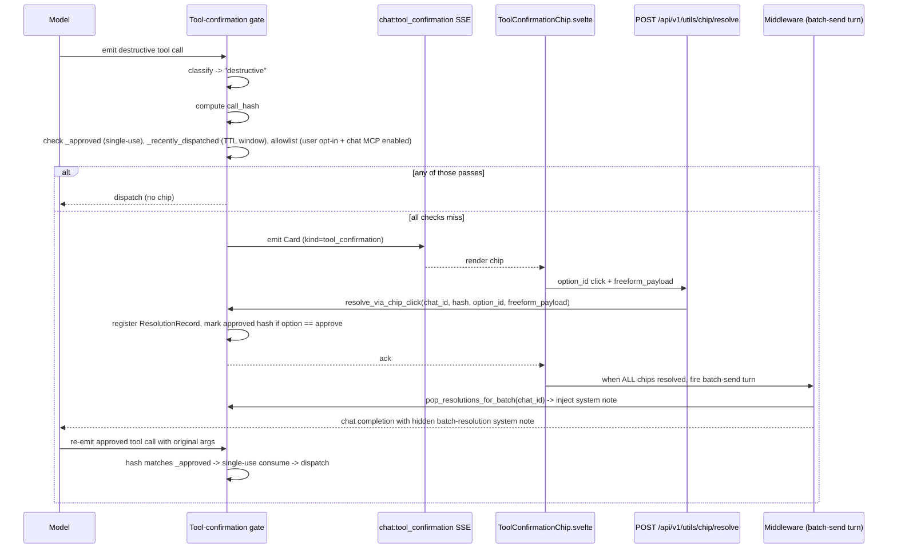

# Chip System -- Technical Architecture

**Audience:** developers and reviewers maintaining the tool-confirmation gate.
**Last reviewed:** 2026-05-04.

## Overview

The "chip system" is the in-chat interactive surface that brokers consent for destructive actions and ad-hoc clarifications. It started as the per-action tool-confirmation chip mandated by threat-model item N-012 (see [`../../security/tool-confirmation.md`](../../security/tool-confirmation.md)) and has since grown into a generic interactive primitive used for:

- Tool-confirmation prompts (Yes / No / Modify with body / Always allow).
- Clarifications proposed by middleware in scheduled-run sub-agent chats (out-of-scope tool calls, auth-required loss).
- Task-creation confirmations in the main chat before `scheduling_create_task` fires.

This document is the canonical end-to-end reference. The user-facing how-to lives at [`../../howto/users/manage-tool-allowlists.md`](../../howto/users/manage-tool-allowlists.md).

Cross-refs:

- [`../../security/tool-confirmation.md`](../../security/tool-confirmation.md) — threat model + destructive-tool catalogue.
- [`../mcp/scheduled-task-runtime.md`](../mcp/scheduled-task-runtime.md) — how scheduled tasks integrate with the chip system.
- [`../../security/hardening-overview.md`](../../security/hardening-overview.md) — overarching security context (`N-012`).

## Card data model

Every chip is a `Card` (one record in the gate's `_pending` map). The card's shape determines what the renderer draws and what option ids the resolver accepts.

```
Card {
  kind: "tool_confirmation" | "clarification"
  hash: string                  # call_hash for tool_confirmation; computed from (kind, prompt, options) for clarification
  prompt: string                # human-readable text rendered above the buttons
  options: [ChipOption]         # the buttons; order is presentation order
  allow_freeform: bool          # whether to render a textarea for freeform reply
  context: { ... }              # opaque proposer-supplied metadata (gate doesn't interpret)
  tool_name: string             # only meaningful when kind == "tool_confirmation"
  mcp: string                   # only meaningful when kind == "tool_confirmation"
  args: { ... }                 # tool args at proposal time, used to seed the modify path
  proposed_at_ns: int
}

ChipOption {
  id: string                    # canonical id; the click payload sends THIS back
  label: string                 # rendered button text
  style: "primary" | "secondary" | "danger"
}
```

Tool-confirmation chips have four canonical options today: `approve`, `cancel`, `modify`, `always_allow`. The first three resolve via the gate's existing hash-bound machinery; `always_allow` resolves like `approve` AND additionally writes a per-user allowlist entry through the gate's pluggable `allowlist_writer_fn` (see "Allowlist" below). Clarification chips have proposer-defined options (e.g. `out_of_scope_block` / `out_of_scope_approve_once` / `out_of_scope_widen_scope`).

## Trust boundaries

| Surface | Who can write | Who can read |
|---|---|---|
| `chat.meta.run_origin` / `scheduled_task_id` / `scheduled_approved_scope` | Scheduling daemon at chat creation only (via OWUI service token) | Middleware reads via `Chats.get_chat_by_id` |
| Gate `_pending` / `_approved` / `_recently_dispatched` / `_resolutions` | Gate methods only (Python in-process) | Same — never serialised over the wire |
| Per-user file-backed allowlists at `<DATA_DIR>/tool-allowlists/<user_id>.json` (round-4 chose flat-file over an OWUI Alembic migration to avoid rebase friction with upstream's migration chain) | User via Settings UI / chip "Always allow" button (verified-user auth check) | Gate reads at evaluate-tool-call time; Settings UI reads via `/api/v1/utils/allowlists` |
| `ScheduledTask.needs_attention` | Middleware (chip propose) and executor (run terminate) only — internal endpoint, NOT exposed via MCP | Frontend reads via `/api/v1/scheduling/tasks` and SSE `scheduling_task_updated` |
| `mcp-policy/destructive-tools.json` | Maintainer-supplied at build time | Gate reads at process start |

The model NEVER writes any of the above. The chip click is a license issued by the user; the gate is the dispatcher; the audit log is the witness.

## Dispatch lifecycle



Dotted-line behaviors:

- The chip click is a license, not a delegation. Approving the chip does NOT call the tool — only the model's next re-emit (with byte-identical args) does, and only against the cached approval.
- `consume_assistant_turn` clears `_approved` at the END of the assistant turn. Anything left unredeemed expires.
- `_recently_dispatched` is a per-`(chat_id, call_hash)` short-lived cache that absorbs upstream-retry races (e.g. Slack cache syncing). It is wallclock-bound, not turn-bound, and survives `consume_assistant_turn`.

## Gate state

```
class ToolConfirmationGate {
    _pending:              dict[chat_id, dict[call_hash, PendingAction]]
    _approved:             dict[chat_id, set[call_hash]]
    _recently_dispatched:  dict[chat_id, dict[call_hash, RedispatchEntry]]
    _resolutions:          dict[chat_id, list[ResolutionRecord]]
    _allowlist_lookup_fn:  callable(user_id, tool_name, mcp) -> bool
    _allowlist_writer_fn:  callable(user_id, tool_name, mcp) -> None
    _registry:             ToolConfirmationRegistry (loaded from JSON once)
}
```

The allowlist storage is deliberately decoupled from the gate via the two pluggable callables; the production wiring uses `tool_allowlist.is_call_allowlisted_for_user` / `upsert_entry_for_user`, while tests inject fakes. The per-chat-MCP precedence check (a planned future short-circuit that requires the chat to have the corresponding `tool_server_id` enabled) is NOT yet enforced — it is a follow-up that wires the chat object's `tool_servers` list into the gate.

Every mutation that takes a real consequence (mark approved, drop pending, register resolution, write allowlist, set attention flag) emits an audit event through `_audit`. See [`../../security/tool-confirmation.md`](../../security/tool-confirmation.md) for the full event vocabulary.

## REST surface

Single endpoint after the KISS prune of the legacy `/tool-confirmation/resolve` wrapper:

| Method | Path | Purpose |
|---|---|---|
| POST | `/api/v1/utils/chip/resolve` | Resolve any chip kind with `{chat_id, hash, option_id, freeform_payload?}` |
| GET | `/api/v1/utils/allowlists` | List the authenticated user's allowlist file (entries + master toggle) |
| POST | `/api/v1/utils/allowlists/entries` | Upsert one entry (idempotent on `(tool_name, mcp)`) |
| PATCH | `/api/v1/utils/allowlists/entries/{entry_id}` | Toggle one entry's `enabled` flag |
| DELETE | `/api/v1/utils/allowlists/entries/{entry_id}` | Hard-delete one entry; 204 on success, 404 if already gone |
| PUT | `/api/v1/utils/allowlists/master-toggle` | Flip the user's master "Allowlists enabled" panic switch |

Cluster bulk-resolve is implemented purely client-side: `ChipClusterGroup.svelte` dispatches one `decision` event per pending chip in the cluster, so the bulk-action buttons reuse the existing `/chip/resolve` endpoint with no new server surface.

The "Always allow" chip click populates the allowlist by passing `option_id="always_allow"` to `/chip/resolve`; the gate's resolver invokes `allowlist_writer_fn` after marking the call approved. Pending-chip ownership is validated via the same chat-ownership ACL as every other chip click.

The task attention flag lives on `ScheduledTask.needs_attention` in the Rust scheduling-server. There is no dedicated REST endpoint; the daemon clears the flag in-process when a successful run terminates and exposes a `clear_needs_attention(task_id)` storage helper that a future "user opened the chat" hook can call.

Every endpoint requires `Depends(get_verified_user)`; per-resource ACLs (chat-ownership, task-ownership) are enforced inside each handler.

## Control-flow scenarios

Three scenarios cover the bulk of real-world chip flows. Each is depicted as a sequence diagram in the relevant section below; this overview gives the high-level shape.

### Scenario A — Interactive chat, single chip

The classic flow. Model emits one destructive tool call; gate proposes a chip; user clicks Yes / No / Modify; on next turn the model re-emits and the gate dispatches. The allowlist and the redispatch TTL are short-circuits inside `evaluate_tool_call` that skip the chip entirely.

### Scenario B — Scheduled-run sub-agent, in-scope tool

```mermaid
flowchart LR
    Daemon[Scheduling daemon fires]
    Daemon -->|"creates chat with chat.meta"| Chat
    Chat -->|"sub-agent emits tool"| Gate
    Gate -->|"classify destructive"| HashCheck
    HashCheck -->|"check chat.meta.scheduled_approved_scope"| Scope
    Scope -->|"in scope"| Approve[mark approved, audit dispatched_scheduled_pre_approved]
    Approve -->|"dispatch in same turn"| Tool
```



In-scope tools never produce a visible chip — the user already approved the class of action at task creation time and `chat.meta` carries that consent into the run.

### Scenario C — Scheduled-run sub-agent, out-of-scope tool, user widens

```mermaid
flowchart LR
    SubAgent -->|"emits tool not in approved_scope"| Gate
    Gate -->|"propose clarification chip"| ChipSSE
    ChipSSE -->|"user clicks 'Approve + widen'"| Resolve
    Resolve -->|"middleware actuates"| RustAPI[scheduling-server PATCH /tasks/{id}]
    RustAPI -->|"persists"| Task[task.tool_server_ids += new id]
    Resolve -->|"system note: re-emit with these args"| SubAgent2[next turn]
    SubAgent2 -->|"hash-bound dispatch"| Tool
```

The widen is actuated by the middleware, NOT by asking the sub-agent's model to call `scheduling_update_task` — sub-agents don't have that tool in scope and the previous attempt to delegate the call dead-ended.

## Stacked / clustered chips

When the model emits N destructive calls in one turn, the gate proposes N chips. The frontend stacks them above the input. The grouping + bulk-action UI lives in `src/patches/frontend/src/lib/components/chat/MessageInput/ChipClusterGroup.svelte` and the pure clustering logic in `chipClusters.js`. To make bulk operations practical without escalating risk:

- Chips with the same `(tool_name, mcp)` form a **cluster** (visual + behavioral).
- Clusters of < `CHIP_CLUSTER_COLLAPSE_THRESHOLD_DEFAULT` (= 6) chips render as a flat list of individual `ToolConfirmationChip` components, no bulk action button.
- Clusters of ≥ 6 chips render **collapsed** as a header showing the cluster size + a "Show all N" / "Hide" toggle. The "Approve all" / "Cancel all" buttons only appear AFTER the user expands the cluster — forces a glance at the full list before mass-approving.
- No fixed numerical cap — the expand-first guardrail scales gracefully whether the model emitted 6 chips or 600.
- Bulk-actions emit one `decision` event per pending chip in the cluster, so the gate's per-hash invariants (single-use approval, audit one event per call) all still hold.

## Allowlist / chat-allowlist behavior

The per-user allowlist is the third short-circuit inside `evaluate_tool_call`, gated by:

```
allowlist_active(user_id, tool_name, mcp) = (
    user_id present (no anonymous bypass)
    AND _allowlist_lookup_fn(user_id, tool_name, mcp) returns True
)
```

If active, dispatch with audit `dispatched_user_allowlist` and seed the redispatch cache. Otherwise, proceed to chip proposal.

The lookup function (production) reads the user's file at `<DATA_DIR>/tool-allowlists/<user_id>.json` via `tool_allowlist.is_call_allowlisted_for_user`. The file's master toggle (`master_disabled: true`) and per-row `enabled: false` both cause the lookup to return `False` so the chip flow runs.

Storage layout (round-4): one JSON file per user, atomic-replace writes, mode 0600. Schema:

```json
{
  "version": 1,
  "master_disabled": false,
  "entries": [
    {
      "id": "<uuid hex>",
      "tool_name": "slack_conversations_add_message",
      "mcp": "slack",
      "enabled": true,
      "created_at": "2026-04-29T12:00:00Z",
      "updated_at": "2026-04-29T12:00:00Z"
    }
  ]
}
```

Path-traversal-y user ids are rejected outright (alnum + `-` + `_` only).

Population modes (round-4):

- **On-the-fly**: chip's "Always allow" button (option id `always_allow`) creates the entry with `enabled: true`. Idempotent on `(tool_name, mcp)`.
- **Manual**: Settings → Allowlists page lets the user toggle / delete entries directly.
- **Prefilled (deferred)**: a future round will introspect newly-authorized MCP integrations' destructive tool lists and create disabled-by-default entries. Currently NOT implemented — the chip's "Always allow" button is the only auto-population path.

Settings UI lives at `src/patches/frontend/src/lib/components/chat/Settings/Allowlists.svelte`. One section per MCP. Master toggle flips the file's `master_disabled` field. Per-row toggle (soft revoke; entry stays off) and X icon (hard delete) with a 5-second Undo toast.

## Redispatch TTL behavior

When the gate dispatches an approved tool call, instead of fully evicting `(chat_id, call_hash)`, it moves the entry into `_recently_dispatched[chat_id][call_hash] = RedispatchEntry(timestamp_ns, ttl_ns)` for ~10 minutes (admin-configurable, env `PORTICO_TOOL_CONFIRMATION_REDISPATCH_TTL_SECONDS`, default `600`, bounds `0..3600`). On subsequent dispatch attempts:

- Hash-identical retry within TTL → audit `redispatch_within_ttl`, dispatch silently. (Solves the "Slack cache syncing" UX bug.)
- Hash-identical retry after TTL → fresh chip.
- Different args → fresh chip (different hash, by design).

`consume_assistant_turn` does NOT clear `_recently_dispatched`. The TTL is wallclock-bound; retries that happen on a follow-up turn within the window still pass.

## Attention flag

Scheduled-run sub-agents that surface chips can sit idle for hours if the user isn't watching the sub-agent chat. The `ScheduledTask.needs_attention` flag (with `needs_attention_reason` and `needs_attention_since`, RFC3339 string) raises an amber dot in the sidebar so the user notices.

- **Set** by the Rust scheduling-server when a run terminates with a "needs human" status: `auth_required`, `missing_integration`, `failed`, `missed`, `interrupted`. The reason field is set to one of `auth_required`, `missing_integration`, `run_failed`, `missed_run`, `preflight_failed`.
- **Clear** by the scheduling-server when a subsequent run terminates with `success` or `cancelled`. The storage helper `clear_needs_attention(task_id)` is exposed for a future "user opened the chat" hook to call from the middleware.

The flag is purely advisory — never grants permission, never bypasses chips. There is no MCP-tool surface for setting / clearing the flag; the model never sees it.

Frontend rendering is the standalone `TaskAttentionDot.svelte` primitive (`src/patches/frontend/src/lib/components/layout/Sidebar/TaskAttentionDot.svelte`). The post-Round-4 wiring mounts the dot in two places, both backed by separate signals:

1. **Per-chat dot (`ChatItem.svelte`)** — driven by the chip gate's `_pending` store via `Gate.chat_attention_for_user(user_id)` and `GET /api/v1/utils/chat-attention`. ChatItem subscribes to `$lib/stores/chatAttention` directly so any caller (Sidebar.svelte, upstream Folders.svelte) gets the dot without prop drilling. See [`../mcp/scheduled-task-runtime.md` § "Sidebar wiring"](../mcp/scheduled-task-runtime.md#sidebar-wiring-chat-level-signal).
2. **Per-task / folder rollup** — driven by the Rust `ScheduledTask.needs_attention` flag. This surface remains a follow-up (`FolderItem.svelte` mount) until we decide whether the rollup belongs in the upstream OWUI folder primitive or in a custom widget.

## Test coverage map

| Concern | Primary test files |
|---|---|
| Gate state machine + chip-click vocab + redispatch TTL + allowlist integration + always_allow chip option | [`tests/test_tool_confirmation_gate.py`](../../../tests/test_tool_confirmation_gate.py) |
| Allowlist storage helpers (file-backed) | [`tests/test_tool_allowlist.py`](../../../tests/test_tool_allowlist.py) |
| Scheduled-run scope binding + auth-required clarification + widen-scope actuation | [`tests/test_scheduled_run_scope.py`](../../../tests/test_scheduled_run_scope.py) |
| Scheduled-tasks skill structural assertions | [`tests/test_skills_scheduled_tasks_skill.py`](../../../tests/test_skills_scheduled_tasks_skill.py) |
| Attention flag + executor + run-terminal cleanup (Rust) | [`src/core-mcp-rust/crates/scheduling-server/src/storage.rs`](../../../src/core-mcp-rust/crates/scheduling-server/src/storage.rs) (in-crate `#[tokio::test]` blocks) |
| Frontend chip + cluster grouping | [`tests/test_tool_confirmation_chip.node.test.js`](../../../tests/test_tool_confirmation_chip.node.test.js) |
| Settings → Allowlists page + REST client | [`tests/test_tool_allowlist_settings.node.test.js`](../../../tests/test_tool_allowlist_settings.node.test.js) |
| Task attention dot primitive | [`tests/test_task_attention_dot.node.test.js`](../../../tests/test_task_attention_dot.node.test.js) |
| Sidebar attention wiring (api client + store + Sidebar refresh + ChatItem render) | [`tests/test_chat_attention_wiring.node.test.js`](../../../tests/test_chat_attention_wiring.node.test.js) |
