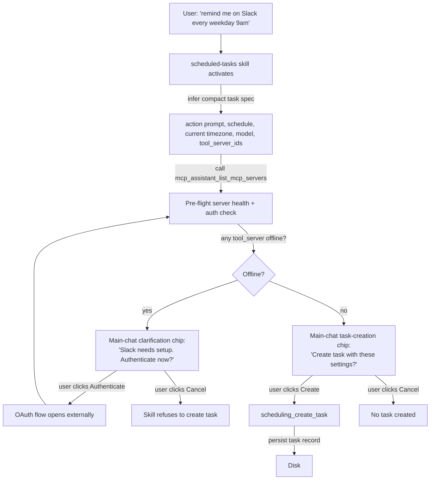
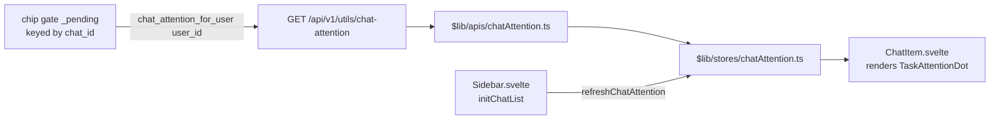

# Scheduled Task Runtime -- Technical Architecture

**Audience:** developers maintaining the scheduling daemon, sub-agent runtime, and the chip-gate integration.
**Last reviewed:** 2026-05-04.

## Overview

A scheduled task is a saved (prompt, schedule, target model, optional skills, optional integrations) record that the scheduling daemon dispatches as a fresh sub-agent chat at the right moment. The lifecycle has three actors:

- **Main chat (interactive)** — the user collaborates with the model to assemble the task spec, runs pre-flight checks, and confirms creation.
- **Scheduling daemon (Rust `scheduling-server`)** — claims runs from cron / once-time triggers, performs run-start preflight, spawns the sub-agent chat with the right `chat.meta`, and polls the run to terminal status.
- **Sub-agent runtime (Rust `subagents-server` + OWUI middleware)** — executes the task's prompt with a constrained tool scope, gated by the chip system for any out-of-scope destructive call.

Cross-refs:

- [`../chat-ui/chip-system.md`](../chat-ui/chip-system.md) — chip gate machinery; this document focuses on the scheduling-specific pieces.
- [`../../security/tool-confirmation.md`](../../security/tool-confirmation.md) — security model for scheduled-run scope binding.
- `skills/scheduled-tasks/SKILL.md` — model-facing instructions for the task-creation flow (in the repo root).

## Task creation pipeline



Two interactive checkpoints:

- **Auth chip** — surfaces only if any required `tool_server_id` is offline or unauthenticated. Lets the user authenticate without leaving the main chat. After auth, preflight re-runs.
- **Task-creation confirmation chip** — always surfaces before `scheduling_create_task` fires, showing the parsed schedule, target model, prompt summary, and approved `tool_server_ids`. The chip is the user's audit moment.

Both chips are clarification-kind chips proposed by the gate; the model itself doesn't render UI.

The creation model should not ask users to supply scheduler plumbing that the app already knows. It uses the current/injected user timezone unless another zone materially changes the request, uses the current model or agent by default, and leaves `skill_ids` empty unless the user explicitly asks to pin a skill. Skills remain available for ad-hoc activation during each run. Integrations are different: `tool_server_ids` are the user's durable pre-approval boundary for unattended side effects and must be selected and pre-flighted before task creation.

The saved `prompt` is an action-oriented job specification, not assumed output or conversational text. Generated instructions refer to the task owner in first person; for example, a break reminder is stored as “Remind me to take a short break” rather than “Time to take a break” or “Remind the user.” The daemon also injects a hidden interpretation contract into every scheduled sub-agent run. This protects tasks created through direct UI/API paths: message-like reminder copy is delivered to the user instead of being interpreted as advice to the model, user-relative pronouns refer to the task owner, relative dates resolve at execution time, and external success is not claimed without tool confirmation.

## Daemon executor lifecycle

```mermaid
sequenceDiagram
    participant Cron as Cron / once-time trigger
    participant Daemon as scheduling-server executor
    participant Bridge as Host MCP Bridge
    participant Preflight
    participant Subagents as subagents-server
    participant OWUI as OWUI chats router
    participant Gate as Chip gate
    participant Loop as Sub-agent run loop

    Cron->>Daemon: scheduled sweep sees task due (on time OR overdue catch-up)
    Daemon->>Daemon: superseded occurrences? record ONE missed row (needs_attention=missed_run), re-arm at most recent occurrence
    Daemon->>Bridge: check Host MCP Bridge readiness
    alt app / bridge not ready
        Bridge-->>Daemon: not ready
        Daemon->>Daemon: DEFER — leave next_run_at armed, retry next sweep (~30s)
        Daemon-->>Cron: done (occurrence NOT consumed; expires into missed only when superseded)
    else app / bridge ready
        Bridge-->>Daemon: ready
        Daemon->>Daemon: claim_and_start_run(task_id)
    end
    Daemon->>Preflight: check_tool_servers_available(task.tool_server_ids)
    alt any offline / not authed
        Preflight-->>Daemon: OfflineToolServer list
        Daemon->>Daemon: record last_run_status = MissingIntegration | AuthRequired
        Daemon->>Daemon: advance schedule (cron) or disable (once)
        Daemon-->>Cron: done (no chat created)
    else all healthy
        Daemon->>Subagents: start_subagent_run(prompt, tool_server_ids, metadata={run_origin, scheduled_task_id, scheduled_approved_scope})
        Subagents->>OWUI: POST /api/v1/chats/new (chat.meta = metadata)
        OWUI-->>Subagents: chat_id
        Subagents->>Loop: drive sub-agent loop until terminal
        Loop->>Gate: every tool call passes through evaluate_tool_call
        Gate->>Gate: in-scope? auto-dispatch. out-of-scope? clarification chip + needs_attention=true
        Loop-->>Daemon: terminal status (success / failed / cancelled / interrupted / auth_required / missing_integration)
        Daemon->>Daemon: record last_run_status, advance schedule, clear needs_attention defensively
    end
```

### `last_run_status` vocabulary

| Status | Semantics |
|---|---|
| `success` | Sub-agent run completed without errors. |
| `failed` | Sub-agent loop returned an error during normal operation. |
| `missed` | A cron occurrence was superseded before it could run: the app/scheduler was down at fire time AND a newer occurrence became current before the scheduler came back (only the most recent occurrence catches up). For `once` tasks: `run_at` passed more than the catch-up window (default 24h, `SCHEDULING_ONCE_CATCH_UP_WINDOW_HOURS`) before the scheduler returned. Sets `needs_attention` with reason `missed_run`. An occurrence that is merely *late* (still current) is NOT missed — it runs as a catch-up shortly after the daemon is back, throttled to one catch-up launch per 30s sweep. |
| `cancelled` | User invoked `scheduling_cancel_run` mid-flight. |
| `interrupted` | Daemon shutdown / restart caught the run mid-execution. |
| `missing_integration` | Pre-flight detected an offline `tool_server_id` (Phase 2). |
| `auth_required` | Pre-flight detected an unauthenticated integration, or mid-run an OAuth-required signal surfaced. Distinct from `missing_integration` so the user knows whether to re-auth or re-install. |

## Trust boundaries for `chat.meta`

The chip gate trusts `chat.meta.run_origin` / `scheduled_task_id` / `scheduled_approved_scope` for in-scope auto-dispatch. That trust is anchored in two facts:

1. The OWUI `/api/v1/chats/new` payload that carries `meta` is only invoked by the scheduling daemon (with the OWUI service token) when spawning sub-agent chats.
2. No MCP tool exposes a write to `chat.meta`. The chip-resolve REST endpoint also does not touch it.

If either invariant changes (e.g. a `chat:tags:update`-style API starts mutating `meta`, or `Chats.update_chat` becomes reachable from the model), the trust boundary MUST be re-audited. Reach out to security before changing those routes.

The defense-in-depth test [`test_forged_user_message_cannot_supply_chat_meta_to_bypass_gate`](../../../tests/test_scheduled_run_scope.py) pins the reader's contract: it only consults `Chats.get_chat_by_id`, never user-message content.

## Scope-binding model

`task.tool_server_ids` is the snapshot of which integrations the task is allowed to use. At dispatch time the daemon copies this list into `chat.meta.scheduled_approved_scope`.

The middleware's `tool_in_scheduled_scope` membership check (in [`scheduled_run_scope.py`](../../../src/patches/backend/open_webui/utils/scheduled_run_scope.py)) compares the destructive tool's `mcp` label (or its tool-name prefix) against the approved scope. Aliases are normalized so `slack` and `slack-mcp` compare equal — the alias map lives in the same module and is intentionally small (no regex, no wildcards).

If the membership check fails, the gate proposes an out-of-scope clarification chip with three options:

- **Block this run** — `out_of_scope_block`. Run ends; audit `cancelled` with `reason="out_of_scope_block"`.
- **Approve once for this run** — `out_of_scope_approve_once`. The original call's hash is registered in `_approved`; the model's next-turn re-emit dispatches against the cached approval. Single-use.
- **Approve + widen task scope permanently** — `out_of_scope_widen_scope`. Same as approve-once, AND the middleware itself fires a `PATCH /tasks/{id}` to the scheduling-server adding the new `tool_server_id` to the task's scope. The sub-agent never calls `scheduling_update_task` — that tool is not in the sub-agent's tool list, and delegating the call to the model dead-ended.

A "never ask again" / "trust forever" option is intentionally NOT offered. That bypass would let a single clarification turn silently grow a model's persistent capability and defeats N-012's per-action invariant.

## Sub-agent guardrails

### No OAuth-flow initiation in sub-agent

Scheduled runs typically execute when no interactive user is watching. If a tool call mid-run returns "auth required" (e.g. Slack token expired), the sub-agent must NOT attempt to start an OAuth flow — there's nobody to consent. Instead:

1. The sub-agent loop detects the OAuth-flow signal in the tool response (specific shape verified in [`subagents-server`](../../../src/core-mcp-rust/crates/subagents-server/)).
2. Aborts the run with `last_run_status = AuthRequired` and a descriptive `last_run_error`.
3. Middleware proposes an `auth_required` clarification chip in the sub-agent chat: "Slack lost authentication during this run. [Re-authenticate now] [Cancel run]". User clicks Re-authenticate → OAuth flow opens in the main app, NOT in the sub-agent's request loop. After successful auth, the user must manually run-now or wait for the next cron firing.

### Pre-flight integration health

The scheduling-server's `check_tool_servers_available` ([`preflight.rs`](../../../src/core-mcp-rust/crates/scheduling-server/src/preflight.rs)) checks both **installation** (config directory exists, not toggled off) AND **authentication state**. Offline or un-authed integrations cause the run to abort with `last_run_status = MissingIntegration | AuthRequired` BEFORE a sub-agent chat is created. The same check runs at task creation time via the skill (model-side) and at run start time via the daemon (defensive fail-closed).

## Attention flag

Long-running scheduled tasks that hit a chip can sit idle until the user happens to open the sub-agent chat. To surface the need for input at the task-list level:

- `ScheduledTask` gains three fields: `needs_attention: bool`, `needs_attention_reason: Option<String>`, `needs_attention_since: Option<String>` (RFC3339 timestamp, kept as a string for serde-roundtrip simplicity).
- The Rust scheduling-server **sets** the flag whenever a run terminates with a "needs human" status — `auth_required`, `missing_integration`, `failed`, `missed`, `interrupted`. The reason string is one of `auth_required`, `missing_integration`, `run_failed`, `missed_run`, `preflight_failed`, `schedule_error` (the last when a cron `next_run_at` could not be recomputed after a run and the task was disabled to avoid a silent never-fires-again state). This bookkeeping lives in `executor.rs::record_preflight_terminal`, `runtime.rs::record_stale_missed_and_rearm` / `mark_once_task_missed` / `advance_schedule_or_disable`, and `storage.rs::clear_current_run_and_record_result` so every code path that writes a terminal status keeps the flag in sync.
- The scheduling-server **clears** the flag whenever a subsequent run terminates with `success` or `cancelled`.
- A storage helper `TaskFileStore::clear_needs_attention(task_id)` is exposed for a future "user opened the sub-agent chat" hook to call from the middleware. It is idempotent — already-cleared tasks return `false` and skip the on-disk write.

The flag drives an amber dot rendered by the standalone `TaskAttentionDot.svelte` primitive in `src/patches/frontend/src/lib/components/layout/Sidebar/`. Round-4 shipped the primitive with structural tests; the post-Round-4 wiring described next mounts it into the sidebar.

### Sidebar wiring (chat-level signal)

The Rust `ScheduledTask.needs_attention` flag is the source of truth for **task-level** "this scheduled job is stuck" semantics. The sidebar's amber dot, however, lives on **chat rows**, so we need a per-chat signal. We piggyback on the chip gate's existing `_pending` store rather than introducing a new chat-meta field:



Reasons surfaced in this path:

| Reason             | When set                                                  | Rendered tooltip                                                      |
| ---                | ---                                                       | ---                                                                   |
| `awaiting_confirmation` | Gate has a pending `tool_confirmation` chip for this chat | "A sub-agent is waiting on your approval to continue."                |
| `awaiting_clarification` | Gate has a pending `clarification` chip for this chat    | "A sub-agent is asking you to clarify before it continues."           |
| `auth_required` / `missing_integration` / `run_failed` / `missed_run` / `out_of_scope_chip_pending` | Reserved for the task-level dot (folder rollup) — same `TaskAttentionDot` component, different host | matches the task-level tooltip vocabulary |

Trust boundaries:

- The route requires `get_verified_user`. The gate filters `_pending` by `user_id`, AND the route additionally cross-references each candidate `chat_id` with `Chats.get_chat_by_id_and_user_id` so a stale `user_id` stamp can't leak someone else's pending chips.
- The endpoint is read-only and intentionally minimal — `{ chat_id, reason }` only — so chip payloads (call args, tool names, …) are never exposed to the sidebar layer.
- `chatAttention` store soft-fails to an empty Map on any error, so a backend hiccup makes the dots disappear (safe default) instead of breaking the sidebar render.

There is no MCP-tool surface for setting / clearing either flag — the model never sees attention state. If a future round adds a clear endpoint reachable from the chat completion path, audit it before exposing to keep the "model cannot hide pending input" invariant.

## Files map

| Concern | File |
|---|---|
| Task data model | [`src/core-mcp-rust/crates/scheduling-server/src/model.rs`](../../../src/core-mcp-rust/crates/scheduling-server/src/model.rs) |
| Task storage (file-backed JSON) | [`src/core-mcp-rust/crates/scheduling-server/src/storage.rs`](../../../src/core-mcp-rust/crates/scheduling-server/src/storage.rs) |
| Pre-flight checks | [`src/core-mcp-rust/crates/scheduling-server/src/preflight.rs`](../../../src/core-mcp-rust/crates/scheduling-server/src/preflight.rs) |
| Daemon executor | [`src/core-mcp-rust/crates/scheduling-server/src/executor.rs`](../../../src/core-mcp-rust/crates/scheduling-server/src/executor.rs) |
| MCP tool handlers | [`src/core-mcp-rust/crates/scheduling-server/src/native/scheduling.rs`](../../../src/core-mcp-rust/crates/scheduling-server/src/native/scheduling.rs) |
| Daemon → sub-agent dispatch | [`src/core-mcp-rust/crates/scheduling-server/src/runtime.rs`](../../../src/core-mcp-rust/crates/scheduling-server/src/runtime.rs) |
| Sub-agent run loop | [`src/core-mcp-rust/crates/subagents-server/src/native/subagents.rs`](../../../src/core-mcp-rust/crates/subagents-server/src/native/subagents.rs) |
| Gate-side scope binding | [`src/patches/backend/open_webui/utils/scheduled_run_scope.py`](../../../src/patches/backend/open_webui/utils/scheduled_run_scope.py) |
| Skill instructions | [`skills/scheduled-tasks/SKILL.md`](../../../skills/scheduled-tasks/SKILL.md) |
| Attention dot frontend | [`src/patches/frontend/src/lib/components/layout/Sidebar/TaskAttentionDot.svelte`](../../../src/patches/frontend/src/lib/components/layout/Sidebar/TaskAttentionDot.svelte) |
| Sidebar attention API client | [`src/patches/frontend/src/lib/apis/chatAttention.ts`](../../../src/patches/frontend/src/lib/apis/chatAttention.ts) |
| Sidebar attention store | [`src/patches/frontend/src/lib/stores/chatAttention.ts`](../../../src/patches/frontend/src/lib/stores/chatAttention.ts) |
| Gate `chat_attention_for_user` method | [`src/patches/backend/open_webui/utils/tool_confirmation_gate.py`](../../../src/patches/backend/open_webui/utils/tool_confirmation_gate.py) |
| `GET /api/v1/utils/chat-attention` route | [`src/patches/backend/open_webui/routers/utils.py`](../../../src/patches/backend/open_webui/routers/utils.py) |
