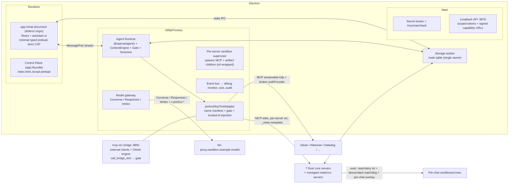

# Native Chat Migration — Removing Docker/OrbStack and Open WebUI

**Status:** v8 — **APPROVED** by Codex CLI (gpt-5.6-sol, ultra reasoning) at review round 8, and by the internal 4-critic review. Eight adversarial rounds; blocker count 11 → 3 → 4 → 2 → 1 → 1 → 0 → 0. Zero blockers, zero unresolved findings remain; residual items are explicitly-accepted trade-offs or named implementation spikes (§14). This is a strategic design doc, not an implementation.
**Scope:** Replace the entire Docker/OrbStack runtime and the patched Open WebUI fork with a chat experience built natively into the Electron app, using the OpenAI Agents SDK (TypeScript) as the agent runtime, at full feature parity with today's product.
**Layers affected:** all 12 — Electron Shell, IPC/Communication, Docker Orchestration (removed), MCP Orchestration, LLM Routing, Chat UI, Agent Skills, Agent VM/Code Execution, State & Persistence, Health Check & Configuration, Observability, Update & Distribution.

> **Review provenance:** v2 resolved round 1 (11 blockers). v3 resolved round 2 (`app://chat` host, storage worker, prompt variants, per-server sandbox ownership, secret-ingress exception, marketplace lifecycle, OAuth callback phasing, docker-only MCP spike). v4 resolves round 3, which corrected four deep architecture facts verified against the repo: (1) **Seatbelt is a filter, not a mount namespace** — it cannot remap `/work`/`/tmp` per concurrent chat, so the path contract migrates to real per-chat absolute paths (or VM-baseline fallback); (2) **core stdio dispatch drops `_meta` and trusts model-supplied `chat_id`** (`runtime.rs:52`) — the adapter must overwrite identity-scoped args and servers must read trusted context, closing a cross-chat forgery hole; (3) **Google Workspace + Slack bind `0.0.0.0:8080` and `mcp-orc` hardcodes 8080** (`session.rs:37`) — host subprocesses need unique loopback ports + wildcard rejection; (4) **scheduled provenance must store the canonical approved scope** (not just a hash), be created transactionally before a run resumes with pre-generated ids, and authenticate `finalize_run`/cancel by run token (`scheduling.rs:310`). v4 also hardened: browser-facing endpoints use signed capability URLs; Rust↔store uses a typed authenticated Unix-socket RPC; the exec supervisor owns child spawn in the utility process; the dual-stack scheduling lease is arbitrated by the Electron supervisor; container→host promotion requires out-of-band consent; legacy-SSE configs are classified. v5 resolves round 4's core insight — **on a shared host, a loopback listener is not private without a network namespace** (§D6a): http-subprocess MCP children (Slack/Google) and artifact inner servers are reachable directly by any same-user process, around the gate. v5 requires child-enforced auth (bearer/mTLS/Unix-socket) or a targeted Virtualization.framework microVM for the workloads that can't authenticate their own listener (artifacts, un-authable subprocesses), with direct-port-bypass/LAN-bind/port-scan tests. v5 also: broadens host-promotion consent to the full resolved launch authority; adds a Slack **Darwin** binary (patched/attested/codesigned) spike or quarantine; defines the code-exec network-allowlist schema + registry baseline + approval UX; adds the 4 dispatcher-routed workspace-bridge routes to the parity ledger; blocks the migration fuse on *any* authoritative-source quarantine; routes M2–M5 native scheduling CRUD into an isolated preview subtree; and makes the intolerant-client handoff capability-selective (dual-publish per channel, updater selects by manifest schema) since EOL routing is channel-wide.

---

## 0. Executive summary

Today the product is an Electron shell orchestrating a 9-service Docker Compose stack (patched OWUI v0.6.43, Bifrost LLM gateway, two MCPO tiers plus ~20 generated per-server containers, Redis, MongoDB, chat-state-api, one-shot health-check, dynamic per-chat agent-VM containers) on OrbStack. The chat UI is a `WebContentsView` pointed at `localhost:3789`; the "middleware" is a 15,449-line fork of OWUI's `utils/middleware.py` plus a 3,561-line filter (`src/filters/unified_context.py`) plus 120 patch files (75 Svelte + 45 TS/JS/mjs, ~48k lines) over the OWUI frontend.

The migration replaces this with five in-app components:

1. **Agent Runtime** — an Electron `utilityProcess` (Node 22) running `@openai/agents` with custom `Model` implementations that speak Portico llm-proxy's three native protocols (Bedrock Converse, OpenAI Responses, Vertex). Ports the context engine, tool loop semantics, confirmation gate, steering, subagents, and scheduling dispatch from the OWUI middleware.
2. **porticoMcpToolAdapter** — a layer that reproduces `mcp-orc`'s exact tool-name manifest (prefixing, renames, disables, collision handling), wraps every tool invocation in the mandatory dispatch gate, injects per-call metadata (as MCP `_meta` for stdio servers), and vends OAuth/broker credentials per request. This is what lets the SDK consume MCP without breaking the prompt/skills/registry name coupling.
3. **Native Chat UI** — a new renderer chat application (React) served from a **separately-originated, sandboxed `app://chat` document** (a second host added to the `app://` protocol handler) with a minimal typed preload, streaming over IPC `MessagePort`s.
4. **Local Store** — one SQLite database (via `node:sqlite`; no native module) owned by a **dedicated storage worker**, plus existing on-disk stores, replacing OWUI's `webui.db`, Redis, and MongoDB/chat-state-api, with a journaled one-time migration fed by pre-exported state files.
5. **Host Execution Layer** — MCP servers and code execution run as host processes under `@anthropic-ai/sandbox-runtime`, one sandbox per server, with **read-deny-by-default** confinement, per-chat overlay environments, and a descendant-tracking RSS/CPU watchdog; artifacts build under the same sandbox and are served by a supervised child behind a loopback reverse proxy with port injection.

The migration runs as a **strangler**: the native stack ships opt-in alongside the Docker stack, reaches parity milestone-by-milestone against the 218-scenario release test plan, then cuts over and deletes the Docker estate. Two hard sequencing constraints dominate: (1) currently-installed updaters hard-reject release manifests without Docker images, so a tolerant updater with **startup capability-version telemetry** must reach a defined saturation threshold *before* any Docker-free payload; (2) a **state exporter** must ship in the last Docker-full release — with one final post-quiesce run during cutover — so migration reads host-side files, never a live Redis/Mongo.

Wins: ~50% of host RAM returned (OrbStack sizing), cold start from minutes to seconds, ~10 GB of images and a ~4 GB OWUI fork deleted, one language for the product core, and removal of an entire class of webview-recovery/auth-bridge/socket-proxy machinery.

---

## 1. Context and motivation

- **Performance is the #1 complaint** (CLAUDE.md constraint; `docs/incidents/2026-03-owui-lag.md`). The Docker stack costs 50% of machine RAM (OrbStack sizing in `install_v2.sh`), multi-minute cold starts (10-min compose cap, 9-min readiness cap in `main.js`), and constant polling (5s Docker status, webview reconnect loops, health cycles).
- **OWUI is a fork in denial.** 120 patch files over the frontend, 34 backend overlay files, an entrypoint that string-patches OWUI at every boot, and a build that grep-verifies 14 patch markers. Every OWUI upgrade is a re-fork.
- **The middleware is the product**, and it lives in the wrong place: `utils/middleware.py` (15,449 lines) + `unified_context.py` implement the agent loop, tool governance, steering, prompt caching, and context assembly inside someone else's web app.
- **Install/update fragility** is dominated by Docker: Harbor pulls, OrbStack restarts, image drift detection, 62 GB managed trees (PORTICO-215).
- **Precedent exists.** The org already executed three agent-driven rewrites (Python MCPO→Rust, health-check→Rust, bridge→Rust; `docs/blog/towards-autonomous-engineering.md`), and host mode already runs MCP servers natively under `@anthropic-ai/sandbox-runtime` with a secret broker.

---

## 2. Current state — what actually exists (inventory anchors)

Verified against the tree; several docs are stale, so the plan is grounded in code:

| Component | Reality |
|---|---|
| Compose stack | 9 services in `docker-compose.yml` + generated `docker-compose.override.yml` with one container per enabled MCP server + dynamic `agent-vm-*` containers spawned via bollard through `docker-socket-proxy` |
| LLM path | OWUI → Rust bridge (`src/bifrost-bridge-rust`, OpenAI-compatible in) → patched Bifrost Go (protocol translation) → llm-proxy `/bedrock/converse` (Claude), `/openai/v1[/responses]` (GPT), `/gemini/v1beta1/...` (Gemini). GPT-5.x already bypasses Bifrost (`GPT_OPENAI_ROUTE_MODE=direct`) |
| Middleware | `src/patches/backend/open_webui/utils/middleware.py` (native tool loop, history reconstruction, gate wiring, steering, overflow spill, stream repair) + `src/filters/unified_context.py` (8-phase per-request context engine) |
| Core MCP servers | **7 Rust crates**: agent-vm (**24 tools** per `tool_spec.json`), artifacts (11), mcp-assistant (17), scheduling (8 + `scheduling-daemon`), skills (31), subagents (11), web-tools (1) = **103 declared tools** |
| **Tool naming** | Core servers advertise **raw** names (`bash`, `create_skill`); `mcp-orc` synthesizes model-visible `{normalized_server_id}_{sanitized_tool}` (e.g. `agent_vm_bash`) at `app.rs:896-918`, applies `tool_rename_mapping`, drops `disabled_tools`, resolves collisions. The 437-line base prompt, skills, and `mcp-policy/destructive-tools.json` reference the **prefixed** names |
| System MCP configs | **23 configured servers**: 7 core + Glean/Atlassian/Datadog/data-plat/product-pal/trust-kit/notifications/ownership/teamworks (remote streamable-http), google_workspace/slack (http_subprocess), gitlab-mcp/chrome-devtools (managed node pkgs), **sourcegraph/n8n (docker-run only today)**, snowflake (uvx + Keychain `runtime_files`; `generator.rs:899-905` rejects `runtime_files` for host deployment) |
| MCPO | Rust `mcp-orc` exposes MCP servers to OWUI as **OpenAPI tool servers**; `openapi-aggregator` + nginx control plane route per-server containers; OAuth callbacks on **3834** route by `state` param to legacy containers (`openapi-aggregator/src/handlers.rs:387`); reload = container restart |
| Host mode (already native) | host MCPO :8890 (native `mcp-orc` under srt — refuses to run unsandboxed, but with **one** union profile for all servers); Host MCP Bridge :8891 (external clients + secret broker; `call_bridge_tool` is a **synchronous name/args call with no chat/turn/caller context and bypasses the gate today**, `bridge.rs:1118`); Electron broker API :9876; Okta setup auth :8877; GitLab marketplace auth :8878 |
| State | OWUI SQLite `open-webui-data/webui.db`; Redis (durable per-chat capability state, VM/artifact registries, steering queues, `SET NX EX` locks, Lua CAS-delete, **LPUSH/BRPOP signal queues** — container-internal `redis:6379`, never published to host); MongoDB via chat-state-api :3835, container-internal; `chat-workspaces.json`, `workspaces/{chat_id}/`, `artifact-snapshots/`. **`app-support/` and `reporting/` default INSIDE `open-webui-data/`.** Marketplace **publish/link records live in Electron userData sidecars** (not `webui.db`), alongside `marketplaces.json` + installed skill dirs |
| Search | `chat_search.py` **deliberately dropped FTS5** at v11; bounded `instr()` substring + literal-prefiltered, candidate-capped regex (N-001). No FTS to "port" |
| Health-check | Rust one-shot container: OWUI configurator + readiness snapshot writer. No Playwright in the Rust path |
| Agent VM | Per-chat Docker containers (python3.12 + Node 22 + LibreOffice + data/PDF/Office toolchain), 1 GiB/2 CPU, `/work` bind-mount. **Network NOT disabled** (bridge `172.31.0.0/16` with egress). Artifacts: one container per artifact; `create_artifact` runs an arbitrary `start_command` on a **stored `container_port` (default 5173) that is only collision-free because each container has its own network namespace**; snapshots as tar.gz |
| Chat UI | OWUI Svelte + patches in a `WebContentsView` (**separate process + `localhost:3789` origin**), auth-bridge session minting, CSP stripping, health probes, blank recovery — ~30 `owui-*` IPC channels |
| Renderer stack | Framework-less vanilla JS (`views/index.html`, CSP `script-src 'self' 'unsafe-inline'`); the `app://` handler **accepts only the `bundle` host** (`app-protocol.js`); main-renderer preload exposes ~260 IPC channels |
| Marketplace estate | AI Marketplace agent install/update/delete via `ai-marketplace-install.js` → `subagents_*` over MCPO-core :8766 + direct SQL on `webui.db`; **publish/unpublish/bundle/link/repair lifecycles** with userData sidecar state; ~39 `ai-marketplace-*` IPC channels; skills marketplaces + OOTB reconcile; GitLab marketplace auth :8878 |
| Distribution | Cloudsmith raw zips per channel; staged updater (`update-preparation.js` **rejects manifests without non-empty `dockerImages`**); `prepare-update-cloudsmith.sh:565` **backs up the live managed tree without quiescing SQLite/WAL**; `apply-prepared-update.sh` runs the **target build's** reconcile with `rsync --delete` over that build's preserve list; installer deletes the previous app bundle after promotion; `@anthropic-ai/sandbox-runtime` already asarUnpack'd |

Load-bearing scale: ~260 IPC channels (13,839-line `ipc.js`), Express API on 9876 (4,976 lines, `Access-Control-Allow-Origin: *`, ~6 of 52 routes authenticated), `docker-mcp.js` 8,614 lines, 218 test-plan scenarios, 103 core MCP tools whose **prefixed names are load-bearing**.

---

## 3. Design decisions

### D1. Agent runtime: `@openai/agents` (TS) in an Electron `utilityProcess`
- SDK `0.13.x` (pre-1.0): **pin and wrap** behind an internal `AgentRuntime` facade.
- Runs in a `utilityProcess` (Node-enabled, off the main thread) with `MessagePort` channels to renderer windows. Electron 39 embeds Node 22.x (SDK requires ≥22) — confirm exact minor at spike time.
- **Tracing disabled on day one** (`setTracingDisabled(true)`); later redirected via `setTraceProcessors()` into our Observability layer.
- **Approval model:** the SDK's interruptions primitive is *not* a drop-in for the chip gate. The gate's semantics (§D5) are layered on top via an **application-owned, versioned checkpoint protocol**: chip clicks and typed text both route into the gate resolver (single source of truth, no privileged side channel); the resolver alone calls `approve`/`reject`; freeform modification = **reject-and-reissue**; serialized interruption state carries `created_at` + tool-catalog hash + agent-graph version and is **expired fail-closed on restore**. **Persisted `RunState` has an explicit at-rest contract:** secret-free (broker material and sensitive-info values never serialize; assert via a serializer allowlist + scrub test) and encrypted with `safeStorage` before touching disk. `RunState` persistence is for crash recovery only — never to carry a live approval across turns.

### D2. Model layer: custom `Model` implementations per provider family — NOT a baseURL swap
Portico llm-proxy is three native protocols; Bifrost exists solely to translate. The replacement is a TypeScript "model gateway" implementing the SDK's `Model` interface directly:

- **`BedrockConverseModel`** (Claude): TS port of `converse.rs` + `prompt_cache.rs` — Converse JSON shaping (toolUse/toolResult/reasoningContent/cachePoint), stream repairs (delta-before-start synthesis, reasoning dedup + signature round-trip, malformed `tool_use` classification, empty-stream `incomplete_stream` synthesis), effort→budget tables (1024/10000/20000/31999), adaptive-thinking models (`thinking:{type:adaptive}` + `output_config.effort`, no `budget_tokens` on Sonnet 5, temperature/top_p/top_k stripped on Opus 4.7+), per-model `anthropic_beta` flags (4.6–4.8 only, deliberately not Sonnet 5), cache breakpoints + canonical tool sorting, 1h TTL for Opus 4.8.
- **`OpenAIResponsesModel`** (GPT-5.x / 4.1): SDK-native Responses + the policy layer: instructions hoisting, `_tool_namespaces` grouping + `tool_search` (the 95%-vs-0% cache-hit difference), `prompt_cache_key`/`prompt_cache_retention`, namespaced tool-call history round-trip, effort mapping (max→xhigh; 5.4-pro rejects low), and fast mode (`service_tier` — per-chat lightning toggle sends `params.service_tier`, extract/strip/inject policy + `GPT_SERVICE_TIER` fleet default port 1:1 from `prompt_cache.rs::apply_openai_service_tier`; served tier echoed into `usage.service_tier`).
- **`GeminiVertexModel`**: Vertex-native `streamGenerateContent` + ported quirks (512-declaration cap with core-tool priority, schema type inference, function-part id stripping).
- All three send the 7 `x-portico-*` headers + bearer `PORTICO_LLM_API_KEY` (Keychain/Vault, already in Electron main).
- **`model_catalog.yaml` stays single source of truth**; pricing unified (kill `costs.rs`↔`model-pricing.js` drift).
- Why not `aisdk()`: beta, thinking/caching fidelity issues through generic hops, and we'd still owe the Converse translation.

### D3. Chat UI: React app in a sandboxed, separately-originated `app://chat` document
Today untrusted content (model output, MCP results, skill/marketplace content) is isolated in a `WebContentsView` on a distinct origin with a narrow bridge; mounting chat inside `index.html` (broad preload, `unsafe-inline` CSP) would hand the V-011 chain (~260 IPC channels) to any renderer XSS.

- **Mechanics (corrected):** `app-protocol.js` accepts only the `bundle` host today. WS3 extends it with a **second host, `app://chat`** — same privileged scheme, distinct host ⇒ **distinct origin** — with its own root, its own page/prefix allowlist, GET/HEAD-only, and the contract test updated (`verify-app-protocol-contract.js` + `app-protocol-contract.unit.test.js`). The chat document runs in its own `WebContentsView` with `contextIsolation`, a **minimal typed preload** (chat `MessagePort` + a small vetted API — never the control-plane preload), and **sender-validated IPC** binding chat channels to that frame (the concrete closure of V-002/V-010).
- Strict CSP (no `unsafe-inline`) via `<meta>` tag in the built entry HTML (the handler injects no headers).
- **Rendering security contract (V-005/V-011):** no `dangerouslySetInnerHTML` for model/tool-derived strings; markdown HTML through an allowlist sanitizer; Mermaid/Vega in sandboxed iframes (no `allow-same-origin`); KaTeX `trust:false`; ANSI handling replaced, not ported. Adversarial XSS corpus (V-005/V-011 fixtures + hostile MCP payloads) is an M3 gate item.
- React + assistant-ui primitives via a custom-runtime adapter bound to the IPC stream; custom components carry the heavy loads (traces, chips, context ring). Vite output under the `app://chat` root.
- Tab detach/reattach becomes state serialization (the `request-conversation-attach-payload` handshake is the head start).
- **Fallback (documented):** fork OWUI's Svelte frontend onto a local backend if parity risk explodes — rejected as baseline, retained as escape hatch.
- Hard perf bar (owui-lag): **O(delta) streaming commits**, 150–350 ms pacing, ONE scroll writer, benchmarked vs the incident table (~7 ms at 80k chars) before beta.

### D4. Persistence: `node:sqlite` in a dedicated storage worker
- **`node:sqlite`** (bundled in Electron 39's Node 22.x; no native module) as primary; `better-sqlite3` documented fallback (Spike E), in which case WS8 owns native packaging (per-arch rebuild, asarUnpack, contract test, prebuild gate per Electron bump).
- **Single DB owner = a dedicated storage worker** (a `worker_thread` inside the runtime utility process, or a second `utilityProcess` — Spike E decides), so synchronous SQLite work (migration, indexing, regex search) **never blocks streaming or tool dispatch**. Renderer, runtime loop, and Rust servers reach it over `MessagePort`/IPC. WAL; `busy_timeout`; one writer; checkpoint + **online-backup API** ownership (backups never copy a live WAL — see §8). All diagrams and IPC contracts reflect this single topology.
- Schema: chats (message tree with `currentId`, structured `contentBlocks` as source of truth + display text), folders/tags/pins/archive, files metadata, models/agents registry, prompt-library entries, message feedback, per-chat capability state, chat-state (context tokens, per-model reasoning effort incl. `"0"` canonicalization), pending work, allowlists, VM/artifact registries, search tables, audit/gate events, and **`scheduled_run_provenance`** (below).
- **`scheduled_run_provenance` (corrected — stores the scope, not just a hash):** rows keyed `(chat_id, task_id, run_id)` storing the **canonical approved scope** (the actual tool/server allow-set the gate tests membership against) plus its `scope_hash`, `created_at`, `expires_at`, and a lifecycle state (`pending`/`active`/`revoked`). The daemon **pre-generates `run_id`** and **writes the row transactionally in `pending` before the run is allowed to resume** — execution never begins before provenance exists (today `scheduling.rs:310` starts before persistence). The gate resolves the *active, unexpired* row for the exact `(chat_id, task_id, run_id)` and checks the requested tool against the stored scope set. `finalize_run`/cancel/revoke are authenticated by a **daemon-issued run token** (not model-supplied task arguments — `finalize_run` currently trusts model args) and flip the row to `revoked`. No UI/IPC/tool/runtime write path exists. Ports `test_forged_user_message_cannot_supply_chat_meta_to_bypass_gate` + new tests: no-write-path, pre-resume-persistence, forged-finalize rejection, stale/expired-scope denial.
- **Search:** re-implement the existing `instr()` + literal-prefiltered ReDoS-safe regex behavior (bounded substring over `body_content` vs `structured_content`, candidate caps, no LIKE fallback). FTS is a future optimization gated on golden-corpus equivalence — not parity scope.
- **State-store contract for Rust servers (corrected transport + full op set):** Rust children cannot use an Electron `MessagePort`, so they reach the storage worker over a **typed, authenticated Unix-domain socket / socketpair RPC** (per-process token injected at spawn). The contract must cover **every Redis operation class the servers actually use**, not just locks: durable string get/set, `set-if-absent + TTL`, compare-and-delete (Lua CAS equivalent), atomic counters, set add/remove/members, key scans, and **TTL renewal**, plus **blocking/long-poll dequeue** (replacing scheduling `LPUSH`/`BRPOP` signal queues and cancel markers). An inventory of current Redis ops per server drives the API surface. Named WS4/WS5 work.
- **Redis, MongoDB, chat-state-api deleted** — after their state moves. Capability state is durable, never evicted.
- Data relocation (§8): `app-support/`, `reporting/`, `workspace-cfg/` move out of `open-webui-data/`; `chat-store.sqlite` placed **on every shipped preserve list**. DB self-healing UX re-targets the new store. New stores get **`clean_full.sh` sweep entries** (N-011) keeping P0-08 green.

### D5. Middleware port: context engine, tool loop, and the gate move into the Agent Runtime
- `unified_context.py` phases → `ContextEngine` with the same prompt-cache-stable `<static_context>`/`<dynamic_context>` ordering, rebuilt per iteration.
- OWUI's follow-up loop → SDK agent loop; per-iteration context refresh; effectively-unbounded tool turns.
- **Base system prompt (corrected): platform variants.** The prompt is shared by both stacks during the strangler period, so a single edit would break the still-primary OWUI stack. Generate **two variants from shared fragments** (build step, like `generate-model-config.cjs`): the legacy variant keeps Docker URLs/container instructions through M5; the native variant replaces the host-rewrite rule, container vocabulary, and VM recipes at M1. The model-visible-copy audit runs at **M1** for the native variant.
- **Tool confirmation gate (N-012) as the single dispatch boundary** for interactive/subagent/scheduled/replayed calls **and both out-of-band ingress paths** — the Host MCP Bridge (below) and the Control-Plane test path (`invoke-mcp-tool` IPC / `docker-mcp.js invokeMcpTool`), which is **routed through `evaluateToolCall()` unconditionally** (not "either/or"); in dev builds it is additionally restricted to non-destructive tools. Hash binding to `(tool_name, canonicalized_args)`, single-use consumed at end-of-assistant-turn, ambiguity-drop-all, fail-closed `hash_mismatch`, allowlists, audit events; hash recomputed at dispatch regardless of SDK item identity. Ported suite (37+8) + new restart/serialization/ambiguity cases.
- **Host MCP Bridge approval protocol (new):** `call_bridge_tool` is synchronous name/args with no chat/turn/chip context and its **caller identity is currently discarded**, so end-of-turn semantics cannot apply. Policy: **destructive calls via the bridge fail closed by default**, returning a structured `approval_required` **challenge** carrying `{tool, server_id, canonical-args hash, challenge_nonce}`. The bridge preserves and binds the **caller's bearer-token id** (already in its salted-hash registry). An operator completes an **out-of-band, one-use approval** in a native app modal (listing caller identity + tool + args); the app mints a one-use grant **bound to `(caller_token_id, server_id, tool_name, args_hash, challenge_nonce, TTL ≤10 min)`**. The client retries carrying the grant in an explicit header/field; the bridge validates the full binding over a private Rust→TS dispatch channel and dispatches through `evaluateToolCall()`. Per-client config may allowlist specific **non-destructive** tools only; there is no "always allow destructive via bridge." Audit events for challenge/approve/deny/expiry.
- Steering/queued prompts, overflow spill (>50k chars → workspace file + `read_hint`), disabled-integration history sanitization, inline image plumbing, descriptive tool-not-found errors, transient retries: ported with tests.
- **New hard invariants (incidents):** replay-time tool-name validation (`^[A-Za-z0-9_-]+$` + registry membership; drop invalid pairs); one readiness oracle for prompt/spec/dispatch; prompt/spec alignment; reasoning-tag normalization as transport detail.
- **Optimization flags:** storage + evaluation in the runtime (WS2); IPC exposure (WS3/WS7); enumerate survivors of the ~10 flags; gate/allowlist flags **fail closed-on**.

### D6. MCP: name-preserving adapter + native consumption; keep the Rust estate where it earns its keep
- **`porticoMcpToolAdapter`:** SDK consumes MCP via `MCPServerStdio` (local) and `MCPServerStreamableHttp` (remote), with the adapter reproducing `mcp-orc`'s **exact tool-name manifest** (prefixing, `tool_rename_mapping`, `disabled_tools`, collision handling) so all 103 names match prompt/skills/history/registry expectations; wrapping every invocation in `evaluateToolCall()`; and propagating trusted request context (chat/message/session/tool-call ids).
- **Trusted identity injection (corrected — closes a cross-chat forgery hole):** today core stdio dispatch **drops `_meta` and the dispatchers trust model-supplied `chat_id`/`requester_chat_id` in the tool arguments** (`core-mcp-shared/src/runtime.rs:52` forwards only `arguments`). Injecting `_meta` alone is therefore insufficient. The adapter **overwrites the identity-scoped arguments** (`chat_id`, `requester_chat_id`, `vm_id` owner, etc.) with the runtime's trusted values before dispatch **and** the core servers are updated to (a) forward `_meta` into `call_tool_impl`'s dispatcher and (b) read identity from that trusted context, never from model-authored args. WS9 adds a **forged-cross-chat test** (a chat-A turn supplying chat-B's id must be rejected/overwritten, never honored). Spike B proves the trusted-context path end-to-end (agent-vm workspace resolution depends on it). Manifest test: all 103 names, aliases, collisions, no-gate-bypass. The OpenAPI translation layer dies.
- **Remote-server auth:** broker-backed **`authProvider`/custom `fetch`** re-vending the scoped token per request with 401 refresh. Spike B includes an expiring-token test (Atlassian).
- **HTTP-subprocess ports (new):** Google Workspace and Slack run as `http_subprocess` servers that bind **`0.0.0.0:8080`**, and `mcp-orc` hardcodes `INTERNAL_HTTP_PORT = 8080` (`session.rs:37`) — safe today only because each ran in its own container netns. On a shared host, WS5 **allocates a unique loopback port per subprocess server, rewrites each server's bind/port configuration to `127.0.0.1:<assigned>`, and rejects wildcard (`0.0.0.0`) listeners** at supervisor ingress.
- **Process ownership (corrected):** the SDK's `MCPServerStdio` spawns and owns the child's connect/close lifecycle **from the process it runs in** — so the **supervisor lives in the runtime utility process** (it owns spawn, srt-profile wrapping of the argv, health, and teardown for stdio MCP + artifact children); Main holds only Keychain/secret vending, windows, and UX. Where a server needs supervisor-owned pipes that the SDK can't spawn (e.g. a pre-sandboxed FD), a small custom `MCPServer` connects over the supervisor-owned socket. The §4 diagram reflects the supervisor in the utility process.
- **OAuth engine boundary (corrected):** the retained Rust OAuth **coordinator lives in the native `mcp-orc`/aggregator host process** (which already serves the `/oauth/{status,current,pending,callback,refresh}` routes — *not* `bridge.rs`, which has no coordinator). It is exposed to TS through a **local authenticated OAuth service API**: `begin-authorization(server_id) → auth URL`, `status`, `complete`, `refresh`. Snowflake's `runtime_files` use **container-absolute target paths** that must be **translated to per-server host paths with argument rewriting** during host materialization. **Callback ownership per phase:** the legacy control plane keeps **3834** through M5 (its state-param router only knows legacy containers); native flows during M4–M5 use **3836** (already provider-registered; the wizard single-server stack is re-hosted natively by then, and wizard vs native usage is serialized). At **M6 cutover** the native engine takes 3834 with a **state-bound callback demultiplexer** that routes native states locally and (during any valve overlap) proxies unknown states to the legacy aggregator. Port-ownership matrix in §7.
- **Runtime files / secrets:** `generator.rs` rejects `runtime_files` for host deployment today — WS5 adds host support: per-server private sandbox roots, `0600` materialization at exact target paths (Snowflake), zeroization on exit/failure/update. **Ingress policy (corrected):** prefer file/FD ingress or brokered JIT; where a third-party server only accepts env (GitLab `GITLAB_PERSONAL_ACCESS_TOKEN`, Sourcegraph, n8n, arbitrary user-installed servers), **tightly-scoped env delivery inside that server's own sandbox is permitted** — with Seatbelt process-info denied, no inheritance beyond the server's process tree, and a `ps eww` exposure test in CI. Wrap/patch servers to file ingress opportunistically.
- **Per-server isolation (hardened):** every **secret-bearing or user-installed** server gets its **own process tree, srt profile, HOME, cache dirs, and lifecycle owner** — no unions. Trust tiers exist only as **profile templates**. Only that server's secrets are readable; only its `allowed_domains` are reachable; write scope limited to its own state dir. Cross-server secret-read impossibility is a tested M5 gate criterion.
- **Docker-only + legacy-transport MCPs (corrected):** sourcegraph and n8n exist only as `docker run` fragments, **user-installed configs may also invoke docker**, and **existing user configs may use legacy SSE transport** which v4 does not support (stdio + Streamable HTTP only). WS5 runs a **feasibility/package/signing spike** for native equivalents (npx/uvx/binary) and ships a **config classifier** over transport + launch method: docker-invoking or SSE configs are rewritten when safely possible, else **quarantined with export + explicit user notice**. **M6 blocks on every *enabled, supported* server** being live natively; any server that must ship later requires an approved export/removal contract and product sign-off — no silent "ships later."
- **Container→host promotion safety (corrected — full launch authority):** promoting a user MCP config from a container to a host process is a **privilege change** (its arbitrary command now runs on the host user). Promotions are **quarantined until an out-of-band consent** approves a hash of the **complete resolved launch authority** — not just `(command, args, profile, domains)` but the resolved executable/package identity, cwd/HOME/write roots, non-secret env values, secret/runtime-file scopes, headers/OAuth/http-subprocess settings, and network policy (the effective descriptor spans `config.rs:65` + `generator.rs:300`). **Re-consent on any material drift.** Thereafter the supervisor enforces **per-process-tree and global RSS/CPU/process-count budgets** on all MCP children (not just exec).
- **Slack has no macOS binary today (new):** Slack ships **Linux ELF** binaries and its rebuild hardcodes `GOOS=linux` (`rebuild-slack-mcp-server.sh:54`). The native feasibility/signing spike must produce a **patched, attested, codesigned Darwin (arm64+x64)** Slack binary — or Slack is **quarantined** — before the M5 OAuth matrix can claim Slack. Same check applies to any other server shipping OS-specific binaries.
- **Keep** (host processes): Host MCP Bridge (:8891; backend re-targets to the adapter registry; `call_bridge_tool` gated per D5), the Rust OAuth engine, and the secret broker (safeStorage-durable, scoped, fail-closed 428). `mcp-orc bridge`'s own Redis usage (overflow/VM-registry) is **named WS5 de-Redis work**.
- **Core Rust servers** stay stdio children with exact tool-name compatibility; changes: state-API swap (incl. scheduling BRPOP→long-poll + CAS locks), exec backend (D7), mcp-assistant re-target (compose ops → supervisor ops), subagents re-target (OWUI REST → runtime headless-session API).
- Config model preserved; compose/nginx generator outputs die; host-process supervisor (PID files, serial queues, port-kills) manages lifecycles. Mid-chat activation is **transactional**: connect → attach specs → update prompt, same turn.

### D6a. Listener privacy: loopback is NOT a trust boundary on a shared host
The deepest de-containerization loss. Docker gave each MCP subprocess and each artifact server its own **network namespace**, so a "loopback" listener was reachable only from inside that container. On a shared macOS host there is no unprivileged netns: a listener on `127.0.0.1:<port>` is reachable by **any same-user process** — other MCP servers, sandboxed exec code with loopback egress, or unrelated local malware — which lets a caller invoke a credentialed MCP child (Slack receives its OAuth token at spawn and its listener has **no inbound credential** today — `session.rs:635`) or an artifact's inner server **directly, around `evaluateToolCall()` and the gate**. Unique ports and signed *outer* URLs do not fix this; the inner listener is still directly reachable, and root-relative assets/fetches/WebSockets from an artifact page are not covered by a single signed URL. Two classes, two mechanisms:

- **Threat clarity (important):** the adversary is a **same-UID local process**. File/socket permissions do **not** help against it — a `0600` file or Unix socket is owned by the user, so a malicious same-UID process is the owner and can open it; srt profiles constrain only *sandboxed* processes, not an arbitrary unsandboxed same-UID process. The only real defenses are therefore **(a) a credential the child enforces that the attacker does not hold, or (b) a network namespace (VM)**. The plan states this plainly rather than leaning on permissions.
- **http-subprocess MCP servers (Slack, Google Workspace):** the child's listener must be **credential-enforcing or netns-isolated**, in priority order: (1) **patch/wrap the server to require a per-spawn bearer/mTLS** the runtime injects on every request (Slack has no inbound credential today — this is a required patch, tracked with the Slack Darwin-binary spike); (2) else run it in the **artifact microVM's netns** (below) so no host peer can reach it; (3) a per-server auth reverse proxy is only additive (it protects the *proxy*, not the raw child) and does not by itself exclude a same-UID caller from the child — so it is used only in front of a credential-enforcing or netns-isolated child. Exec/other-server sandboxes still **deny loopback egress** to these ports (defense in depth against *sandboxed* callers). A **direct-port-bypass test** (an unsandboxed same-UID process calling the child directly) is an M5 gate criterion and must fail to reach any tool.
- **Artifact inner servers (arbitrary user/LLM code, e.g. `python -m http.server`):** the child cannot be trusted to bind loopback-only or authenticate (SRT's `allowLocalBinding` emits wildcard rules), so the **only** sound isolation is a **targeted Virtualization.framework microVM** (Lima `vz` / Apple `container` — a VM, not Docker/OrbStack) scoped to artifact serving + any un-authable subprocess, giving a real netns so the listener is reachable only through the supervisor's proxy. If the VM is rejected for footprint, the **accepted-and-signed-off residual** is explicit: a same-UID local process can reach the inner port; compensating controls are keeping artifacts secret-free, aggressive teardown, and a loopback-bind profile — but this is a genuine trust reduction, not a mitigation to equivalence. Decision recorded in §14.
- **Artifact full-session auth (corrected — cookies don't work under iframe sandbox):** a sandboxed iframe without `allow-same-origin` has an **opaque (`null`) origin**, so a same-origin session cookie is not sent on `fetch()`, and cookies **don't isolate by port** (RFC 6265) — a cookie mechanism would be both non-functional and a cross-artifact ambient-authority hole. Instead, isolation is by **origin + partition, not cookies** — with the capability credential kept out of persistent, attacker-readable state: (1) each artifact is served on an **unguessable per-open capability host** (e.g. `https://a-<random>.artifact.localhost` mapped by the reverse proxy), so the capability travels in the `Origin`/`Host` of **every** subresource, `fetch()`, and WS upgrade automatically and the proxy authorizes by it — no header/cookie needed; (2) each artifact renders in a **dedicated per-artifact `WebContentsView`** (a plain iframe cannot select an Electron session; today's `artifact-views.js` already uses per-artifact views but a *single shared disk-persistent* session) with its **own in-memory, cache-disabled, non-persistent partition** (a bare `artifact-<id>` partition, **not** `persist:`, since `persist:` is disk-backed with caching on — a same-UID process could otherwise recover the capability host from cache/storage and replay it). Responses set `Cache-Control: no-store` and `Referrer-Policy: no-referrer`; the capability host **rotates per open and is revoked on close**. The proxy rejects any request whose host capability it did not mint. This is a **named mechanism + Spike** (confirm capability-host routing, in-memory partition isolation, WS upgrade, and rotation/revocation all hold), combined with the microVM (or signed-off residual) for the inner listener. **LAN-bind + port-scan + subresource/WS-auth + cross-artifact-isolation + same-UID cache/disk-disclosure tests** at M6.

### D7. Code execution: per-exec srt sandbox, READ-deny-by-default, descendant-tracked watchdog, per-chat overlays
- Per-chat "Agent VM" becomes a per-chat **sandboxed host execution context**: same 24-tool surface and semantics (`/work` = chat workspace, read-before-edit, silent recovery, `.sensitive` isolation + redaction, overflow spill).
- **Filesystem contract (corrected — the deep one):** Seatbelt is a **path filter, not a mount namespace or path virtualization layer**. Docker gave each VM its own namespace, so the constant paths `/work` and `/tmp` resolved to a *different host directory per chat*. Seatbelt cannot do that — it can only allow/deny *real* paths, so two concurrent chats cannot both see `/work`/`/tmp` mapped to different roots. Therefore the **`/work`/`/tmp` contract migrates to real, per-chat absolute paths**: each exec's working directory and model-facing paths become the chat's **real workspace dir** (the already-resolved `work_bind_source`, e.g. `…/workspaces/{chat_id}`) and a **real per-chat scratch dir**, and each concurrent exec's Seatbelt profile is scoped to only that chat's real subtree — distinct real paths, no remapping, concurrency-safe. This is an **enumerated migration** across every surface that hardcodes `/work` or `/tmp`: all 24 agent-vm tools, base-prompt VM recipes, skills that reference `/work`, artifact `start_command`s that assume cwd, `execute_skill_script` staging, and overflow-spill file paths. Model-visible copy is re-audited alongside (M1 native prompt variant). **If this contract migration proves worse than a VM**, the fallback is a Virtualization.framework microVM (Lima `vz` / Apple `container` — a VM, *not* Docker/OrbStack) that restores the namespace and keeps `/work`/`/tmp` verbatim; the fleet (Intel + macOS 13) and cold-start budget argue against VM-baseline, but Spike D makes the call with a **concurrent two-chat isolation test** as an exit criterion.
- **Read confinement:** the exec profile is **READ-default-deny** (allowlist: this chat's real workspace subtree, managed toolchain, this chat's scratch, system libraries) and explicitly denies Keychain, Apple Events/**LaunchServices** (documented srt escape), and Unix sockets. M4 gate test: sandboxed `cat ~/Documents/x` / `ls ~/Library/Application Support/Google/Chrome` **must fail**, and chat-A exec cannot read chat-B's workspace.
- **Resource caps (corrected for escapees):** macOS doesn't enforce `RLIMIT_AS`; memory is enforced by a **watchdog that walks the full descendant tree** — the watchdog periodically re-enumerates all descendants of the exec's session root (not just the initial process group, since a child can `setsid`/`setpgid` to escape a single pgid) and kills the whole tree over an RSS/`phys_footprint` budget. `RLIMIT_CPU` (cumulative SIGXCPU) and `RLIMIT_NPROC` (fork-bomb) are set, plus a wall-clock kill timer and `taskpolicy -b`. **Honest limitation:** an aggregate *2-CPU parallelism ceiling* is a VM/cgroups property macOS cannot enforce for a host process tree — it is an **accepted delta** (CPU is bounded by cumulative-time + wall-clock kill, not core count) unless the VM-backend fallback is chosen. "A ballooning or fork-bombing process tree is killed at ~1 GiB, including after `setsid`" is a **Spike D exit criterion on Intel + AS**. Advertised per-tool `timeout` params — silently ignored today — are enforced.
- **Per-chat overlay environments:** a shared managed venv + shared scratch would allow cross-chat poisoning/leakage or break the documented `pip install`/`npm install` persistence contract. Each chat gets an **immutable managed base toolchain** plus a **private per-chat overlay** (its own `HOME`, scratch dir, Python venv layered over the base, npm cache) — created on first exec, torn down on expiry, quota-capped, and reachable only through that chat's Seatbelt profile.
- **Network (mechanism, not just posture):** exec egress moves from today's unrestricted VM network to **default-deny through srt's domain-filtered proxies**. Because skills/code do `pip install`/`npm install`, this needs a real product mechanism, not just a flag: a **domain-capability schema** (per-workspace allowlist entries), a **registry baseline** always allowed (pypi.org + files.pythonhosted.org, registry.npmjs.org, and the Portico npm/uv mirrors), a **per-workspace approval UX** (add-domain chip/settings, persisted with the workspace binding), and tests. Exec profiles also **deny loopback egress to 9876/8891 and to sibling MCP/artifact listeners** except vetted routes. If the approval UX slips, the deny-by-default-with-registry-baseline is the shippable floor, recorded as a signed-off behavior delta.
- **Toolchain parity:** uv-provisioned Python 3.12 base (pinned wheels: pandas/matplotlib/openpyxl/pypdf/pdfplumber/python-docx/pptx/reportlab/markitdown…) + Node 22 + jq, provisioned at install/first-use. **LibreOffice** is an open decision (bundle vs on-demand brew vs drop) — an explicit behavior delta from the Linux image.
- **VM-backend fallback:** if Spike D fails read-deny or the resource-cap criteria, retain a VM backend (Lima/`vz` for the fleet, Apple `container` for AS/macOS-26 futures) and keep the `agent_vm_*` gate exemption; do not ship a weaker sandbox.

### D8. Artifacts: snapshots stay; serving is a supervised sandboxed child + reverse proxy
- Keep the `artifact-snapshots/` tar.gz + metadata format (users have data) and the 11-tool surface, including `create_artifact`'s arbitrary `start_command` / working dir / stored `container_port` contract.
- **Serving (corrected):** a static `http.createServer` silently drops the dynamic-server contract. Instead a **sandboxed child-process supervisor** runs the `start_command` under the D7 profile, behind a **loopback reverse proxy** on an OS-assigned outer port (`127.0.0.1:0`). **Inner-port collision (corrected):** today's stored `container_port` (default 5173) is only collision-free because each container had its own netns; on a shared host, concurrent artifacts collide. The supervisor **allocates a fresh inner port per running child** and applies it through **three mechanisms, because env injection alone cannot relocate a persisted literal** like `python -m http.server 5173`: (1) set `PORT` in the child env; (2) substitute a `{{PORT}}` placeholder in the stored command; (3) for legacy commands with a hardcoded literal port, **rewrite the literal** to the assigned port (with a conservative matcher). If a command cannot be safely rewritten (ambiguous literal), the supervisor **serializes that artifact onto its stored port** (one at a time) or fails with actionable guidance rather than silently colliding. The reverse proxy maps the stable outer URL to the live inner port. Readiness probes, log tails, crash handling, and process-group teardown replace the `pkill`-regex logic.
- Rendering isolation: **the authoritative mechanism is §D6a** — a dedicated per-artifact `WebContentsView` with an in-memory non-`persist:` cache-disabled partition and an unguessable per-open capability host (a plain iframe cannot select an Electron partition, and `allow-same-origin` is not a `WebContentsView` control). Strict CSP and `no-store`/`no-referrer` apply; distinct capability host = distinct origin. WS6 implements per D6a.
- Prototypes publishing (`artifact-publisher.js`) already reads snapshots, not containers — survives nearly unchanged.

### D9. Configuration reconciliation replaces the health-check container
- A native `ConfigReconciler` (in the runtime) keeps the health-check's hard-won behaviors — idempotent, fingerprint-gated, backup-before-destructive-change — applied to the local store: model catalog → model registry (+ icons, default model, Konami gate for GPT-5.4 pro), `agents/` → agent registry, LM Studio probe/sync, one-time migrations.
- A single **readiness oracle** (fed by supervisor events + OAuth state) replaces `health_status.json`; the Control Plane UI reads it over IPC. No polling on prompt paths (fail-open staleness preserved).

### D10. Observability: in-process event bus, same contracts
- The bridge's reporting files (`payloads/`, `events/`, `errors/` with cost + correlation fields) and the `llm_debug:events` schema survive as an in-process event bus with file sinks; the LLM Debug Monitor UI is re-fed from it (React frontend survives; Redis subscriber dies). Cost dashboard keeps reading the same schema (relocated out of `open-webui-data/`).
- Correlation-field set (`chat_id`, `message_id`, `debug_request_id`, `upstream_request_id`, `request_phase`, `followup_index`, transcript anchors) from day one; gate audit events; `[STREAM-TPS]`-equivalent logging; persisted skip/decision logs.
- **Diagnostics/bug-report re-grounded (WS7):** `diagnostic-collector.js` snapshots Docker version/container states/logs today; re-point it at supervisor process states + the event bus, keeping the `upload-debug-logs`/`collect-diagnostic-snapshot`/`get-bug-report-identity` contracts stable — the support tooling most needed during the M6 beta.

### D11. Identity and secrets
- Okta setup auth stays (host-side; :8877). OWUI auth bridge, service user, session minting, `WEBUI_SECRET_KEY`/`OWUI_AUTH_BRIDGE_SECRET` die. App is explicitly single-user; `PORTICO_USER_ID` (LDAP) rides every LLM call for cost attribution. GitLab marketplace auth (:8878) survives.
- Keychain-first resolution unchanged. Docker secrets tmpfs ingress dies; the scoped broker survives as the single secret authority (per-server scoping enforced by D6 per-server sandboxes). Remote-MCP token custody: broker vends short-lived material per request; runtime never persists it. N-003 "docker exec env" release checks replaced with host equivalents (`ps eww` sweep + Seatbelt process-info-deny assertion) so "raw value only in owning process memory" is re-proven — with the explicit env-ingress exception (§D6) documented as scoped-inside-own-sandbox, not global env.

### D12. Language boundary policy
- TypeScript: agent loop, context engine, gate, model adapters, MCP adapter, persistence, UI, artifact serving/supervision.
- Rust keeps: MCP core servers, OAuth engine, Host MCP Bridge, scheduling daemon.
- Python eliminated from the product runtime (remains only where MCP servers themselves are Python, e.g. google_workspace via uv).

---

## 4. Target architecture

**Surviving ports:** 9876 (loopback, scoped tokens), 8891 (Host MCP Bridge), 8877 (Okta), 8878 (GitLab marketplace), 3834 (OAuth — native takes it at M6 cutover via a state-bound demux), 3836 (native OAuth during M4–M5), ephemeral artifact outer+inner ports, debug-monitor (may fold in). **Deleted:** 3789, 4583, 8765/8766/8767, 8890 (folds into supervision), 3835, 5540, 6379, 27017, 8770.

---

## 5. Feature-parity contract

Acceptance skeleton = the **218-scenario test plan** (`docs/testing/plan/**`) re-grounded on the new stack + the incident invariants (Appendix A). The per-server tool parity checklist is **generated mechanically from each crate's `tool_spec.json`** (103 declared tools: 24+11+17+8+31+11+1) **plus the dispatcher-routed-but-undeclared routes** — notably the agent-vm **workspace-bridge routes** (`copy_from_workspace`, `copy_to_workspace`, `list_workspace_files`, `write_to_workspace`; `agent-vm-server/src/native/mod.rs:145`) — which must each be explicitly **ported or retired**. Parity is inventoried from dispatcher behavior, not advertised tools alone.

**Conversation core:** streaming chat with reasoning blocks (all providers), structured `contentBlocks` persisted as source of truth + reconstructed per request, branching tree with edit/resend/regenerate(+menu)/continue, fork-chat-at-message into a new tab (client-side truncation, `originalChatId`/`branchPointMessageId` provenance), multi-model responses, mid-chat model switch preserving history, cross-window stop, per-model reasoning-effort selector (catalog-driven), context-usage ring (catalog-driven window clamping), title generation via task model (Haiku 4.5), attachments (upload → workspace copy + zip safety extraction; file-only synthetic prompt), TTS read-aloud, transparent upstream-retry status events, rate-limit retry with cancel.

**Agentic UX:** progressive-disclosure ActiveCapabilities badges, skills auto-activation (keyword triggers, 7-day persistence, required-server eligibility snapshots, references/scripts, hot-reload on next request incl. mid-turn, OPT_FLAG content gating), tool-confirmation chips (four options incl. freeform modify + Always-allow, clustering ≥6, batch-send, hash binding, redispatch TTL, attention dots), clarification chips for scheduled runs, mid-turn steering (Enter) + queued prompts (Alt+Enter, edit/cycle/cancel), agent traces (typed collapsibles + embedded script extraction, durations, copy), live subagent stats + detached read-only subagent windows, inline tool images/files, user-question/sensitive-info/workspace-consent modals, ask-user-question + wait tools.

**Tools & integrations:** all 23 system servers + user-installed CRUD (≤50, validation), toggles + per-tool disable + renames, two-phase setup (toggle→authorize→activate) + error playbook, OAuth flows (DCR, non-DCR, PKCE, Slack user_scope + token file, Google bundled creds, bootstrap mode), static secrets via broker, same-turn tool availability after activation, destructive-tools registry (96 rules + glob fallback) + scheduled scope binding + per-user allowlists (+ Settings UI, master toggle, 5s undo), **re-classified host-exec tool rules** (§9), MCP metadata (`_meta`) + logrepo usage telemetry, Host MCP Bridge external clients + auto-config writers + the new bridge approval protocol.

**Code exec & artifacts:** 24 agent-vm tools (bug-for-bug except documented fixes: enforced timeouts, per-chat overlays, ephemeral ports), workspace model (canonical + consented custom folders, inheritance, move-on-id-change, private-VM-root hiding), silent recovery/tombstones/aliases, 1h inactivity expiry with workspace preservation, sensitive-info flow (masked modal, 15-min TTL, redaction), `execute_skill_script` with scoped env, overflow spill + `read_fragment`/`grep_file` paging, 11 artifact tools, version snapshots/switch/restore/download, panel + detached windows + version menu with running indicators, static preview fallback, Prototypes publish.

**Shell & organization:** tab system (persistence, rename priority, busy/unread, ≤5 visible, suspension with warm-tab protection, keyboard map, drag-out detach/reattach with live state), **conversation deep-link routing** (internal scheme replacing `/c/<uuid>` interception, tab-reuse vs new-tab, cross-window focus; handles legacy `/c/<uuid>` in migrated content), sidebar (folders/pins/archive/clone/download JSON+TXT+PDF, Open Workspace, scheduled-tasks entry, attention dots), search (`instr()`-based global modal with filters, ReDoS-safe regex + eval budget, recents, pagination, `<mark>` highlighting, jump-to-message) + in-chat find, model selector (brand grouping, trait badges, availability/disabled reasons, pricing, default Claude Sonnet 5), scheduled-tasks pages, settings (Interface/Data Controls/Allowlists), **prompt library CRUD/import/export**, **custom-agent create/edit UI**, **message feedback (RateComment)**, **landing-page suggested prompts**, theming (dark default, Portico Sans, compact 0.9 scale, Cmd+/−), clipboard reliability, cost dashboard, log viewer, debug request markers + monitor, **diagnostics/bug-report + upload**, Konami unlock, guided setup + OAuth wizard.

**Marketplace estate (full lifecycle owner):** AI Marketplace agent **install/update/delete/publish/unpublish/bundle/link/repair** re-targeted from MCPO :8766 + `webui.db` SQL to the runtime registry + chat-store, **including the userData sidecar link/publish records + `marketplaces.json` + installed skill dirs** (migrated in §8 with hashes/counts); skills marketplaces (add/remove/sync/OOTB reconcile); GitLab marketplace auth (:8878). Lifecycle tests in WS9.

**Deliberately dropped (needs product sign-off + pre-cutover export tooling per surface):** voice input/dictation, RAG/embeddings/vector DB, OWUI code interpreter, channels/community sharing, profile/signup, MoA merge (confirm usage first), the never-implemented VM pool semantics.

---

## 6. Workstreams

**WS0 — Enablers & spikes (blocks everything)**
1. **Tolerant updater + telemetry:** manifest schemaVersion 3 (Docker-optional); **installed-build capability-version phone-home** (logrepo) so saturation is measurable; **rejection-memo** (persisted per build id) so intolerant clients don't re-download rejected payloads. Fix PORTICO-215 disk mechanics in the same touch (rsync `-H`, trap temp cleanup, workspace-excluded backups).
2. **State exporter (last Docker-full release, M6−1):** on health cycle / shutdown, snapshot Redis via a **semantic key allowlist** (never a blind "dump all durable state") — `chat_tools:`/`chat_skills:`/auto-enable/artifact-VM registries and durable `pending_chat_work` (queued prompts/steers, no-TTL, `pending_chat_work.py:477`) — plus Mongo `chat_states`, with an **explicit denylist for credentials/locks/caches** (e.g. `openwebui:api_token` is a no-TTL bearer, `app.rs:1416`; `*_lock`; transient caches) and a **secret-scan test** on the export so no token lands in managed-tree JSON or backups. **One final post-quiesce run at cutover**; exporter-coverage telemetry; the allowlist is checked against the §8 source list so a missed key class fails closed.
3. Spike A: `BedrockConverseModel` PoC vs llm-proxy (tool-use + adaptive thinking + cache-point round-trip, cache-read telemetry).
4. Spike B: SDK loop + `MCPServerStdio` via `porticoMcpToolAdapter` (name-manifest fidelity, gate wrap, **`_meta` metadata path**, broker `authProvider` + expiring-token test on Atlassian, interruption→checkpoint approval with **restart-expiry + ambiguity-drop** exit criteria).
5. Spike C: streaming renderer benchmark (O(delta) vs owui-lag table) in the sandboxed `app://chat` document.
6. Spike D: read-deny srt exec profile + descendant watchdog + per-chat overlay on Intel + AS, macOS 13+ (exfiltration test + fork-bomb + "killed at ~1 GiB"; VM-backend fallback if it fails).
7. Spike E: `node:sqlite` viability (transactions, `instr()`/regex search, cross-process access) vs `better-sqlite3` fallback + the storage-worker topology.
8. Decide UI stack (C), memory-cap mechanism (D), SQLite binding + owner topology (E).

**WS1 — Model gateway** (D2): three adapters + retry/timeout hardening (pre-first-byte retry w/ Retry-After, 90s idle + total + post-progress budgets, `incomplete_stream` synthesis, retryable-504), catalog loader, pricing unification, LM Studio provider, cost/usage events. Port the bridge's regression fixtures.

**WS2 — Agent Runtime** (D1/D5): utilityProcess host, SQLite-backed sessions, ContextEngine (8 phases + static/dynamic order), tool loop with per-iteration refresh, gate + allowlists + `scheduled_run_provenance` + **bridge/invoke-mcp-tool ingress gating**, steering/queued prompts, overflow spill, history sanitization + replay validation, subagent execution (in-proc child runs; server-side count/model/effort caps per the Opus 4.7 sweep), scheduling dispatch re-target, task-model calls, optimization-flag storage/eval, event bus.

**WS3 — Native Chat UI** (D3): `app://chat` host + protocol-contract update + minimal preload + sender-validated IPC, transcript renderer with the rendering security contract, composer (chips, steering/queue, effort selector, context ring, capabilities badges, attachments, workspace badge), search modal + navigation contract + deep-link routing, sidebar, scheduled-tasks pages, settings, prompt library, agent create/edit, feedback, landing suggestions, modals re-targeted REST→IPC, theming/fonts/scale, cost + debug markers, diagnostics UI. Strict CSP.

**WS4 — Persistence & migration** (D4, §8): schema, dedicated storage worker + state-API primitives (CAS, TTL, long-poll), `instr()`/regex search, `webui.db` importer + Redis/Mongo **file-export** importers + marketplace/prompt/feedback records, **shadow-import mode** (M2+ read-only dry-run vs live data with telemetry), journaled staged import (source hashes + count reconciliation + collision rules + **fail-closed on missing/quarantined sources**), self-invalidating migrator-version fuse (store-integrity + webui.db fingerprint for post-rollback delta re-import), quiesce-before-backup, repair/rollback UX, preserve-list updates + data-dir relocation out of `open-webui-data/`.

**WS5 — MCP host-native** (D6): per-server sandbox supervisor (per-server profiles/secrets/HOME/domains), **porticoMcpToolAdapter** (name manifest + gate + `_meta`), SDK MCP wiring (stdio + streamable-http + broker authProvider + 401 refresh), OAuth engine service API + callback demux, `runtime_files` host support + `0600` materialization + zeroization + env-ingress exception handling, readiness oracle, mcp-assistant/subagents re-target, **bridge overflow-path de-Redis + scheduling signal-channel replacement**, config generator simplification, **docker-only MCP feasibility spike + config classifier** (sourcegraph/n8n/user configs), Host MCP Bridge re-target + `call_bridge_tool` approval protocol, guided-setup single-server OAuth bootstrap re-host, **marketplace re-target** (install/publish/link/repair off MCPO/webui.db + sidecars).

**WS6 — Code exec & artifacts** (D7/D8): exec backend swap (bollard → read-deny srt + descendant watchdog + per-chat overlays), managed toolchain provisioning, LibreOffice policy, enforce tool timeouts, sensitive-info + consent flow re-transport, artifacts sandboxed child supervisor + reverse proxy + **inner-port injection**, panel/version-menu adaptation, snapshot compatibility.

**WS7 — Config reconciler & control plane** (D9/D10): ConfigReconciler, readiness IPC feeds, Control Plane UI re-pointing (server cards/status/logs from supervisor), health-badge semantics, LM Studio sync, **diagnostics re-grounding**.

**WS8 — Distribution** (§10): install v3 (no OrbStack/Harbor; toolchain provisioning; VPN-hostile retry culture), update pipeline Docker-phase removal, packaging (new renderer bundle, srt closure, host binaries, SQLite binding), CI rewiring (drop kaniko runtime-images; keep Orka signing + broker MR flow), **permanent schema-2 rescue channel** (Docker-full tolerant-updater build + Harbor retention exception) + tested two-hop old→bridge→native flow, **persisted `minimumCompatibleBuild` floor + enforcement** across Install-Specific-Build / bootstrap / external installers, OrbStack/image reclaim migration, `clean_full.sh` sweep re-derivation.

**WS9 — Test & security re-grounding:** port gate tests (37+8 + restart/ambiguity), consistency runners re-targeted onto a **runtime headless-chat API** (the `owui-headless-chat-testing` harness dies), 218-scenario editions with **every section mapped to a gate** (§7), perf budget suite (O-01..O-05 + streaming), security re-audit (N-012 at new boundary + bridge/IPC ingress, V-002/V-010 sender validation, V-005/V-011 XSS corpus, srt read-deny + RSS-kill + fork-bomb, per-server secret-isolation, host-exec tool re-classification, 9876 endpoint-inventory contract, `scheduled_run_provenance` no-write-path, threat-model delta), dual-stack mutual-exclusion (scheduling, ports), rollback-after-migration, migration dirty-corpus, `data-testid` + verifier endpoints from day one.

---

## 7. Phasing — strangler sequence with per-phase stack & port ownership

Every phase names a **single writer per shared store** and a **port owner**; violating either is the dual-stack failure mode.

| Store / port | M1–M2 owner | M3–M5 owner | M6 cutover | Notes |
|---|---|---|---|---|
| Scheduling dispatch (task files + locks) | legacy container daemon | legacy container daemon (native = shadow/dry-run) | **Electron-supervisor-arbitrated lease transfer**: the Electron supervisor (the only process that sees *both* the Linux-VM daemon and the native daemon) stops the legacy daemon, verifies its process is gone and no run is in-flight, writes a monotonic **lease-epoch file**, then starts native dispatch. A bind-mounted lock file is *not* a valid cross-kernel lease — the supervisor owns the handoff | double-fire hazard; native daemon refuses to execute until the supervisor grants the current epoch |
| Scheduling **task CRUD** (create/update/delete task JSON, `scheduling.rs:16`) | legacy writes shared files; native CRUD → **isolated preview task subtree** | same | **deterministic merge at cutover** (below), not blind "adopt" | native CRUD must not write the shared task files pre-M6 (they drive the legacy daemon) |
| `mcp_toggles.json` / `mcp_tools_config.json` / `mcp-configs-user` | legacy | legacy writes; native reads | native | native uses an isolated preview subtree until M6 to avoid cross-writes |
| Workspaces / artifact-snapshots | shared (append-only per chat; ids disjoint) | shared | native | live VMs/artifacts destroyed at cutover, files preserved |
| Chat history | legacy `webui.db` (native preview = fresh store) | legacy primary | migrator imports → native store | shadow-import validates from M2 |
| OAuth callback :3834 | legacy control plane | legacy control plane | **native demux takes 3834**; valve compose (if any) must not bind it | native uses :3836 during M4–M5 |
| :8890 host-mcpo / :8891 bridge | legacy host-mcpo | folds into native supervision | native | bridge stays up throughout; backend re-targets |

**M0 — Enablers shipped.** WS0 items 1–2 complete; tolerant updater + capability telemetry at **defined saturation** (see below); state exporter shipping. *Gate: Docker-free payloads safely receivable; §K tolerant-updater scenarios green.*

**M1 — Native vertical slice (hidden).** New `app://chat` UI + runtime + model gateway + storage worker behind a dev flag: streamed multi-provider chat with reasoning, tool calls via the adapter. **Stack-ownership:** M1 tool calls scoped to servers with no Redis dependency (web-tools, chrome-devtools, remote streamable-http) OR the state-API pulled forward; a minimal **core-binary build/package/supervisor slice** moves into WS0/M1; the gate runs against the **packaged app**. Native base-prompt variant patched here. Docker stack primary; fresh store, no migration. *Gate: P0 smoke natively; §I model-gateway parity; cache-hit + streaming perf ≥ current.*

**M2 — Middleware parity.** ContextEngine, skills, gate + chips + allowlists + `scheduled_run_provenance`, steering/queues, subagents, scheduling dispatch (**native = shadow only**), overflow, observability bus. Core servers de-Redis'd under the supervisor with the state-API. Shadow-import begins. *Gate: §D + §G (minus code-exec) + gate suite (incl. serialization/ambiguity) + §L-18..23; consistency runners at current pass rates.*

**M3 — UI parity.** Full §5 shell/organization incl. search, artifacts panel plumbing, scheduled-task pages, settings, prompt library, agent edit, deep-link routing, diagnostics UI. *Gate: §B/§C/§E/§F/§M/§N; V-005/V-011 XSS corpus; perf budgets (O-01..O-05 + streaming).*

**M4 — Exec & artifacts native.** Read-deny srt exec + descendant watchdog + per-chat overlays + managed toolchain + sandboxed artifact supervisor. Docker only under the legacy stack. *Gate: §J + artifacts; sandbox security review (read-deny, RSS-kill, fork-bomb); host-exec tool re-classification; threat-model-delta sign-off incl. `scheduled_run_provenance` re-audit.*

**M5 — MCP fully host-native.** All feasible integrations + user-installed servers on per-server-sandboxed host processes; OAuth flows container-free on :3836; bridge re-targeted + `call_bridge_tool` gated; marketplace re-targeted. Docker-only-MCP spike outcome determines which servers ship now vs later (with sign-off). *Gate: §G/§H; OAuth e2e matrix (Slack, Google, Glean, Atlassian, data-plat); per-server secret-isolation test; §G marketplace CRUD/publish.*

**M6 — Migration & cutover.** Under a maintenance barrier (writers quiesced, final post-quiesce export), the journaled migration (§8) runs; scheduling **lease transfer** completes; native demux takes :3834; native becomes default. **Safety valve (corrected):** *not* "read-only OWUI" (no read-only mode exists). Ship a **native legacy-snapshot viewer** over imported data + the pre-migration backup zip; pin **`minimumCompatibleBuild` as a durable monotonic floor** persisted in Application Support and written by the installer/updater (owner: the update system), so Install-Specific-Build / bootstrap / external installers cannot downgrade below a native-store-reading build. **Installs predating the floor** (an old build with no floor written) cannot self-enforce it, and an already-shipped installer invoked manually can still `rsync --delete` native paths it doesn't know about. This is an **irreducible residual** — no already-distributed binary can honor a floor or preserve paths added after it shipped — bounded to pre-tolerant-updater installs and mitigated only by the permanent Docker-full rescue build always being their applicable newest package (so they move forward rather than sideways). Explicitly accepted; not a mechanism gap. Beta first, forward-fix. *Gate: shadow-import telemetry ≥99.5% as ENTRY criterion; migration success ≥99.5%; §A install v3 + §K migration-release; rollback-after-migration scenario green; one clean beta cycle.*

**M7 — Deletion.** Stable rollout; delete the Docker estate (§12) except the pinned rescue-channel build; ship OrbStack/image reclaim; EOL-redirect stragglers to the rescue channel; retire legacy installer generation. *Gate: full §L sweep; §A/§K final.*

**Saturation gate (defined):** cohort = installs that emitted a capability-version phone-home in the last **30 days** (the active-install denominator); threshold = **≥98%** of that cohort on a tolerant (schema-3-capable) build before the first Docker-free payload ships to any non-preview channel.

**Capability-selective handoff (corrected — channel is the only pre-download signal):** a client selects the newest package by timestamp **before** it ever downloads a manifest (`selectLatestPackageForCurrentBuild`, `updates.js:619`), so same-channel dual-publish cannot work — an intolerant client would pick the newest ZIP, download it, then reject schema-3 and loop. The only signal available *before* download is the **channel/package name** (from the `UPDATE_CHANNEL` file). Therefore:
- **Schema-3 Docker-free builds ship on a distinct native channel/package** (e.g. `portico_native`). The **legacy channel keeps only schema-2 builds**, with the permanent tolerant/rescue build (Harbor image-retention exception) as its newest package — so a client that only understands schema-2 always selects a build it can apply and is **never bricked by construction**.
- **Tolerant clients are moved to the native channel by the M6 migration build itself**, which writes the `UPDATE_CHANNEL` file as part of applying the update (channel-switch is an existing capability). After M6 they poll the native channel and get Docker-free builds.
- **Never EOL-redirect legacy → native.** The existing EOL resolver persists the redirected channel **before** downloading the target (`updates.js:1058`) and the intolerant updater then rejects schema-3 (`update-preparation.js:539`) — a direct legacy→native redirect would strand exactly the clients it's meant to rescue, and old `bootstrap.sh` clients can't interpret EOL routing at all (`bootstrap.sh:183`). EOL routing, if used, may only ever point to **another Docker-full / schema-3-tolerant feed**, never to native.
- **The legacy feed permanently keeps a Docker-full, schema-3-tolerant rescue build as its newest package.** Because the tolerant/rescue build carries a non-empty `dockerImages` manifest, *every* intolerant or dormant client — including bootstrap clients that only follow their own channel — always selects a build it **can** apply, becomes schema-3-capable, and is never bricked. This is the load-bearing invariant, not a redirect.
- **Channel switch to native happens only from inside an already-capable client, after that client's migration fuse commits** (the M6 build writes `UPDATE_CHANNEL=native` post-migration). A still-intolerant client is therefore never pointed at a schema-3-only feed. Bounded discovery holds because the legacy feed accrues no schema-3 builds, so the rescue build stays newest (page 1).

**Rollback preserve-path forward-compat:** old reconciles use a **fixed** preserve list with `rsync --delete` (`managed-runtime-reconcile.sh:8`), so a downgrade can delete data dirs a future build introduced. The tolerant/rescue build ships a **prefix-based, app-owned-data-preserving** reconcile (preserve `chat-store.*`, relocated `app-support`/`reporting`/`workspace-cfg`, and any `portico-owned/` prefix) so future paths survive a downgrade to it; installs predating this can only be protected by the rescue build itself (the residual noted in M6).

Critical path: WS0 → WS1/WS2 → WS3 → WS4 migration → M6 (WS4–WS9 all gate M6). Effort (team-relative, high uncertainty): WS0 L; WS1 M; WS2 XL; WS3 XL; WS4 L–XL; WS5 XL; WS6 L; WS7 M; WS8 M; WS9 L.

---

## 8. Data migration (one-time, journaled, on-update, fail-closed)

Sources keyed by chat id move with **per-source hashes + count reconciliation**, ids stable, under a **maintenance barrier** (writers quiesced; **no live WAL/Redis/Mongo reads** — SQLite is checkpointed + copied via the online-backup API, and Redis/Mongo come from the M6−1 exporter's **final post-quiesce run**):
1. `webui.db`: chats (JSON tree incl. `currentId`, contentBlocks *and* legacy flattened messages; tolerate `_chat_corrupt_backup`/`recovered_from_corruption` remnants like `sanitizeInvalidChatRows`), folders, tags, pinned/archived, files (+ `uploads/`), models (custom agents `portico_agent_*`, user models, access-control across human/service/legacy-admin owners → single user), settings, **prompt library, message feedback**.
2. **Redis/Mongo via file exports** (never a live container): capability keys, artifact/VM registries (live VMs destroyed; workspaces preserved), Mongo `chat_states` (re-clamp against catalog), and **`pending_chat_work`** (authoritative, exporter-only, non-expiring — `pending_chat_work.py:497`). **A successful final post-quiesce export is a fail-closed precondition for M6** — there is no "import anyway with loss" for authoritative exporter-only data. If the exporter never ran or cannot produce a current snapshot, M6 **blocks** and the exporter is (re)started under the still-present Docker stack to produce it. `pending_chat_work` is specifically **drained-or-exported with a proven-empty check** (a live confirmation that the queue is empty), never assumed empty — because absence in an export cannot otherwise be distinguished from loss. The degraded-with-notice allowance applies **only** to the reconstructible capability-badge class.
3. **Marketplace state:** userData sidecars (publish/link/repair records) + `marketplaces.json` + installed skill dirs — imported with hashes/counts; lifecycle re-pointed to the runtime registry.
4. **`pending_chat_work`** (durable, no-TTL queued prompts + mid-turn steers): drained or migrated explicitly — queued prompts are re-enqueued into the native store's pending-work table; in-flight steers are dropped with a notice (they are turn-scoped). Not migrating it silently loses queued user work.
5. `chat-workspaces.json` + `workspaces/{id}` + `artifact-snapshots/` — verify bindings; **relocate `app-support/` + `reporting/` + `workspace-cfg/` out of `open-webui-data/`** in the same release (re-point `PORTICO_APP_SUPPORT_DIR` / workspace-cfg / cost-reporting dir), integrity-verify tasks/fuses, only then is M7+1 `open-webui-data` deletion safe.
6. Tool allowlists (`tool-allowlists/*.json`), `mcp_toggles.json`/`mcp_tools_config.json` (format survives). **`portico-tab-state` needs no migration** — it is the shell renderer's own `app://bundle` localStorage (`state.js:59`); a bootstrap shim ignores stale `localhost:3789/c/<uuid>` urls and rehydrates tabs from the stored `conversationId` (graceful drop for quarantined ids).

**Source inventory & backup (corrected):** the updater backup must cover **every** source above — including the **userData marketplace sidecars** (publish/link records) and `pending_chat_work`, which today's managed-tree backup misses. The exporter/backup manifest is checked against this list; a missing source is a fail-closed condition (below).

**Preview-store merge (corrected):** preview users (M1–M5) already have a native store with preview-created chats (disjoint uuids). At M6 the migrator **unions** the imported legacy chats with the preview store; on the (asserted-impossible) uuid collision, the **preview-created record wins** and the collision is logged for review. Deterministic, not "assume disjoint."

**Preview *task & config* subtree reconciliation (corrected):** the same determinism applies to the isolated preview subtrees for scheduled tasks and MCP config that M2–M5 native users wrote (§7). At M6 they are **merged, not blindly adopted**: preview-created tasks/config union into the real store; on id collision with a legacy record the **preview version wins and the collision is logged**; a preview deletion of a record that also exists in legacy is honored (tombstoned) so a delete isn't silently resurrected by the legacy copy. Preview scheduled tasks were shadow/non-executing (§7), so no run history is lost. (If this proves too complex, the shipped fallback is to make preview task/config mutation **ephemeral** — reset at cutover with a user notice — rather than merge.)

**Fail-closed vs degraded (reconciled + fully classified):** every source is classified. **Authoritative** (loss ⇒ fail-closed, fuse blocked, notice): chat history, prompts, message feedback, marketplace publish/link records, custom models/agents, folders/tags, file uploads, user settings, tool allowlists, and queued prompts (`pending_chat_work`). **Reconstructible** (loss ⇒ allowed with notice): only the per-chat capability badges (`chat_tools`/`chat_skills`/auto-enable), which re-derive from chat content on next use. Nothing is left unclassified; the count threshold applies solely to the reconstructible class.

**Mechanics:** migrator runs at first native launch **after M6** (trigger: migrator-version fuse absent AND store not marked migrated). Sources come from checkpointed SQLite (online-backup API, never a live WAL) and the exporter's **final post-quiesce run** (never a live Redis/Mongo). Quarantine rules are **source-class-aware**: quarantining **any authoritative row** (chat/prompt/feedback/marketplace-link) — even a single one, below any count threshold — **blocks the fuse** for operator review (fail-closed); only reconstructible/nonessential rows may be quarantined-and-continue. The count threshold applies solely to the reconstructible class. **Fuse is self-invalidating** (keyed to migrator version AND store integrity; records a `webui.db` content fingerprint so a forward-update after rollback detects post-rollback legacy writes and offers **delta re-import**). `chat-store.sqlite` lives on **every shipped preserve list** so old reconciles can't `rsync --delete` it. Replay-time tool-name validation makes historical bad names safe.

## 9. Security plan

- **N-012 gate re-implementation is a ship-blocker** for any build exposing destructive tools. Single dispatch boundary through `evaluateToolCall()` covering interactive/subagent/scheduled/replay/**bridge**/**invoke-mcp-tool** paths; hash binding to canonicalized args; single-use; ambiguity-drop; fail-closed drift; restart-expiry on serialized approvals; the bridge approval protocol (§D5); audit events.
- **Host-exec tool re-classification (widened):** re-review all of `mcp-policy/destructive-tools.json` + `tool-confirmation.md` under the host-exec model. Post-Docker, `mcp_assistant_toggle_integration`/`activate_integration`/`create_user_mcp_server`/`update_user_mcp_server` launch arbitrary configured commands as **host** processes, and artifact `create/switch/open/restore` re-execute a stored `start_command` (host code exec) — several ungated or generic-glob today. Add explicit rules with meaningful summaries (surface the command that will run), one-time out-of-band consent (not a model-loop chip) when a user-installed server's command/args change, and strict command/path/server-id schema validation at supervisor ingress. M4/M5 deliverable.
- **Read-confinement + resource caps:** read-deny-by-default exec profile with Keychain/AppleEvents/LaunchServices/Unix-socket denials; descendant-tree watchdog for memory (RLIMIT_AS not enforced on macOS); per-chat overlay isolation; tested at M4.
- **Per-server MCP isolation:** one srt profile/process-tree/HOME per secret-bearing or user-installed server; cross-server secret-read impossibility tested at M5.
- **Secrets (N-009):** file/FD ingress or brokered JIT preferred, **never child env** — with the documented exception that env-only third-party servers get scoped env **inside their own sandbox** (process-info denied, no inheritance, `ps eww` test); remote-MCP token custody = broker vends short-lived per request; N-003 checks replaced with host `ps eww` + profile assertions.
- **9876 loopback:** loopback is not an auth boundary and CORS is `*` today. Prefer MessagePort/stdio/private-Unix-socket for new state traffic; RPC-style endpoints require a **per-consumer scoped bearer** (per-process tokens at spawn) + strict origin + schema validation; exec/MCP profiles deny loopback egress to 9876/8891 except vetted routes; a **checked-in endpoint-inventory contract test** makes the reduced surface auditable.
- **Browser-facing endpoints (corrected — can't send bearer headers):** **workspace files/images/downloads** (`/workspace/:chatId/*`, an unauthenticated GET today, `workspace-file-serving.js`) are loaded by ``/download navigations that **cannot attach an Authorization header** — replace raw-path serving with **short-lived, path- and chat-bound signed capability URLs** (HMAC token embedding `{chat_id, path, exp}` minted by the runtime per render), or a custom authenticated `app://`-style protocol served through a preload, so a co-resident process (or sandboxed exec code with loopback egress) cannot enumerate another chat's files by guessing paths (M4). **Artifacts** use the stronger **§D6a mechanism** (dedicated `WebContentsView` + in-memory partition + unguessable per-open capability host), not the signed-URL scheme, because artifacts serve a full dynamic session; that is the authoritative artifact story (M6).
- **Renderer:** sandboxed `app://chat` document + minimal preload; strict CSP; contextIsolation; V-002/V-010 sender validation closed here; V-005/V-011 XSS corpus in WS9; keep `shell.openExternal` validation; ReDoS-safe search preserved.
- **Threat-model delta** (de-containerization) reviewed by security before the M4 gate; `clean_full.sh` sweep re-derived for every new persistent store (N-011); `scheduled_run_provenance` no-write-path re-audit (N-012 trust boundary).

## 10. Performance plan

Budgets (CI/nightly): cold start ≤5 s (expect seconds — no compose), main renderer ≤800 MB after 1 h, bulk toggle ≤8 s, tab suspension reclaims memory, streaming commit O(delta) with 150–350 ms pacing + ONE scroll writer, token-delta IPC coalesced (flush per frame), no new timers without justification (O-03). Deleting the 5s Docker poller, webview reconnect loops, and health-check cycles is a headline win; do not re-introduce equivalents (sanctioned recurring work — subagent stat polling foreground-gated, artifact health pings — carries over). The storage worker keeps synchronous SQLite off the streaming/dispatch path.

## 11. Testing & verification

- Re-grounded 218-scenario plan is the parity ledger; **all 16 sections mapped to gates** (§7): §I→M1, §D/§G/§L-18..23→M2, §B/§C/§E/§F/§M/§N→M3, §J+artifacts→M4, §G/§H→M5, §A/§K→M6/M7, §O every gate. Update evaluators alongside behavior.
- New **runtime headless-chat API** replaces `owui-headless-chat-testing` and drives consistency runners (Google Workspace, code-exec follow-up, calibration, Atlassian steer, Opus reasoning/cache validations) — re-pointed, not dropped.
- Unit-port priority: gate (37+8 + serialization/ambiguity), chip clustering, steering/pending-work, search (`instr()`/regex parity vs golden corpus), tab/detach/modal-routing, converse/prompt-cache fixtures; **adapter name-manifest test (all 103 names + collisions + no-gate-bypass)**.
- Adversarial: V-005/V-011 XSS corpus + hostile MCP payloads; dual-stack mutual-exclusion (scheduling double-fire, port collisions); rollback-after-migration; migration dirty-corpus (real `webui.db` with corrupt rows, flattened messages, legacy-admin ownership); sandbox read-deny + RSS-kill + fork-bomb; per-server secret isolation; 9876 endpoint-inventory contract; bridge approval protocol.
- Perf: streaming benchmark vs owui-lag table; memory/cold-start nightly; prompt-cache hit-rate telemetry as a release health metric.

## 12. Deletion inventory (at M7)

Compose files + 9 Dockerfiles + `docker/`; `docker-socket-proxy`; OrbStack machinery; `build_docker_images.sh`, `fix-health-check-image.sh`, image plan/pull/status/compose-command JS; `docker-mcp.js` Docker paths; OWUI fork (`Dockerfile.open-webui-patched`, `src/patches/**` = 75 Svelte + 45 TS/JS/mjs frontend + 34 backend + entrypoint, `requirements-open-webui-slim.txt`, filter/agent managers + Playwright-era Python, auth bridge, `owui-*` IPC, `owui-views.js`/`chat-webview-preload.js`/auth-session/blank-recovery, obsolete overlay windows); Bifrost Go + patches + `src/bifrost-bridge-rust` (after the TS port proves out; keep runnable until M6+1); `openapi-aggregator` + nginx control plane + compose/nginx generator outputs; Redis/Mongo/chat-state-api containers + `src/chat-state-api/`; `src/event_publisher.py`; health-check container; single-server compose stack after wizard re-host; CI `runtime-images`/`verify-runtime-images`/`promote-latest` + kaniko child pipeline; legacy installer generation. **Retained past M7:** a pinned Docker-full tolerant-updater build in the rescue channel with a Harbor retention exception (the permanent EOL-redirect bridge). Update `docs/TO_REMOVE.md` rows as each lands; fix stale docs (`artifact-versioning.md` pool design, litellm-era `reasoning-effort.md` tables, `oauth.md` Python-era sections).

## 13. Risk register

| # | Risk | Mitigation |
|---|---|---|
| 1 | Claude fidelity through a TS Converse port | Spike A; port Rust fixtures; cache-read + error telemetry gates; keep Rust bridge runnable until M6+1 |
| 2 | Old updaters reject Docker-free manifests | WS0 tolerant updater + capability telemetry + rejection-memo + permanent schema-2 rescue channel; defined 98%/30-day saturation gate; EOL-redirect two-hop |
| 3 | UI parity underestimated (75 Svelte + 45 TS patch files) | §5 contract + scenario ledger; assistant-ui primitives; Svelte-fork fallback; M3 gate blocks cutover |
| 4 | Trust-boundary collapse (chat DOM in shell) | `app://chat` distinct-origin host + minimal preload + sender validation + strict CSP + rendering security contract + XSS corpus (§D3/§9) |
| 5 | Sandbox weaker than container (reads/egress/caps/cross-chat) | Read-deny profile + full-descendant-tree watchdog + LaunchServices denial + per-chat overlays + per-server isolation; Spike D VM-backend fallback if tests fail (§D7) |
| 5b | Seatbelt can't virtualize `/work`/`/tmp` for concurrent chats | Migrate the path contract to real per-chat absolute paths across all 24 tools/prompt/skills/artifacts; VM-backend fallback restores namespaced paths; concurrent two-chat isolation is a Spike D exit criterion (§D7) |
| 5c | Cross-chat identity forgery (servers trust model `chat_id`) | Adapter overwrites identity-scoped args + servers read trusted `_meta` context (`runtime.rs:52` fixed); forged-cross-chat test (§D6/§9) |
| 5d | Host subprocess port collision / wildcard bind (8080) | Unique loopback port per subprocess server + config rewrite + wildcard rejection (§D6) |
| 5e | Browser endpoints unauthenticated (can't send bearer) | Signed path+chat-bound capability URLs / authenticated protocol for workspace files + artifact iframes (§9) |
| 5f | Loopback listener reachable by any same-user process (no netns) → gate bypass | Child-enforced auth (Unix socket / auth proxy / per-spawn bearer) for MCP subprocesses; targeted microVM or accept-and-sign-off for artifact inner servers; cross-sandbox loopback-egress deny; direct-port-bypass + port-scan tests (§D6a) |
| 5g | Slack has no macOS binary (ships Linux ELF) | Darwin patched/attested/codesigned binary spike or quarantine before M5 OAuth matrix (§D6) |
| 6 | Migration data loss / rollback deletes native store | M6−1 exporter + final post-quiesce run + journaled reconcile + fail-closed fuse + store on every preserve list + self-invalidating fuse + delta re-import + snapshot-viewer valve + minimumCompatibleBuild fence (§8) |
| 7 | Dual-stack double-execution / port collisions | Per-phase single-writer + ownership + port matrix; native scheduler shadow-only until the M6 lease transfer; mutual-exclusion tests (§7/WS9) |
| 8 | Tool-name coupling broken by native MCP | porticoMcpToolAdapter reproduces the exact `mcp-orc` manifest + 103-name test + `_meta` metadata path (§D6) |
| 9 | Gate semantics lost under SDK interruptions / bridge | App-owned versioned checkpoint protocol, resolver-only approve/reject, restart-expiry, hash re-check at dispatch, bridge one-use out-of-band approval, invoke-mcp-tool gated (§D1/D5) |
| 10 | Prompt-cache cost cliff (95%→0%) | Namespace packaging + instructions hoisting ported; hit-rate telemetry as release metric |
| 11 | SDK pre-1.0 churn | Pinned version + `AgentRuntime` facade; fallback = swap loop impl behind facade |
| 12 | SQLite native-module burden / blocking main | `node:sqlite` (no native module) primary in a dedicated storage worker; better-sqlite3 fallback with WS8 packaging owner (Spike E) |
| 13 | Scheduled-run auto-approve forgery / stale scope | daemon-only `scheduled_run_provenance` keyed `(chat_id,task_id,run_id,scope_hash)` + expiry + revoke-on-finalize/cancel/timeout; gate queries active-unexpired row; no UI/IPC/tool write path (§D4/§D5/§9) |
| 14 | Docker-only MCPs (sourcegraph/n8n/user configs) | WS5 feasibility/package/signing spike + config classifier (rewrite/quarantine/sign-off); "all 23 at M5" gated on the spike (§D6) |
| 15 | Env-only secret exposure post-de-containerization | File/FD ingress preferred; scoped-env-inside-own-sandbox exception with process-info denial + `ps eww` CI test (§D6/§D11/§9) |
| 16 | Long dual-stack maintenance | Aggressive milestones; freeze OWUI-patch feature work except P0; delete replaced surfaces where safe |

## 14. Open decisions (need owner sign-off)

1. UI stack after Spike C (assistant-ui vs custom React; React vs Svelte).
2. Memory-cap mechanism after Spike D (descendant watchdog vs VM-backend fallback), **and explicit product/security sign-off on the accepted delta that no aggregate 2-CPU parallelism ceiling exists for a host process tree** (VM-only property) — accept, or trigger the VM backend.
2b. **Listener-privacy mechanism (§D6a):** targeted Virtualization.framework microVM for artifacts + un-authable subprocesses, vs accept-and-document the same-user-local-process residual with compensating controls. This is the central de-containerization security trade-off.
3. SQLite binding + storage-owner topology after Spike E (`node:sqlite` worker_thread vs second utilityProcess vs better-sqlite3).
4. LibreOffice policy (bundle vs on-demand brew vs drop with messaging).
5. Legacy safety-valve form (native snapshot viewer vs longer-lived compose valve) + rescue-channel lifetime.
6. Debug monitor: standalone React app vs fold into Control Plane.
7. chrome-devtools-mcp / browser-automation egress posture under the new sandbox.
8. Custom-agent create/edit: native page vs consolidation into control-plane `agents.js`.
9. Windows/Linux packaging targets (nominal today) — in or out of scope.
10. Timeline/staffing calibration against the real team.

## Appendix A — Non-negotiable invariants from incidents

1. Streaming render O(delta), one scroll writer (owui-lag).
2. Structured contentBlocks are the model-facing source of truth; display strings never are (history-flatten).
3. Raw reasoning tags are transport detail; tag-set-driven, model-agnostic normalization (thinking-flash).
4. Assume pathological MCP payloads; keep overflow spill + compaction + tool results inspectable in history (glean).
5. Validate tool names on replay; a stored bad name must never brick a chat (invalid-tool-name).
6. One readiness oracle for prompt/spec/dispatch; prompt claims and tools array never disagree (first-run-tool-spec + invalid-tool-name).
7. Idle + total stream timeouts, incomplete-stream synthesis, retryable-504, correlation IDs end-to-end (converse-stall).
8. Dedicated drag strip; hidden native views collapse to 0×0 (titlebar).
9. Per-chat capability state is durable, never evicted (redis-persistence).
10. Enforce subagent count/model/effort server-side (opus47 sweep).
11. Retry-with-backoff + safe-to-re-run on all network paths (install tracker).
12. Mid-turn activation is transactional: connect → attach specs → update prompt, same turn (first-run-tool-spec).
13. The tool-confirmation gate runs below the model on every dispatch route, including the external-client bridge and dev test-invoke path (N-012).
14. Scheduled-run approved-scope (the canonical scope set, not just a hash) is written only by the daemon, per-run, transactionally before the run resumes, in a tamper-evident store the model/UI/IPC cannot mutate; finalize/cancel/revoke are authenticated by run token and expire the grant (tool-confirmation trust boundary).
15. Server-side identity is never taken from model-authored arguments: the runtime injects trusted `chat_id`/requester ids and servers read them from trusted request context, so a turn in chat A can never act on chat B (metadata-trust; `runtime.rs:52`).
16. Untrusted exec code sees only its own chat's real workspace + scratch subtree (read-deny-by-default); it can read nothing else on the host, and no host subprocess binds a wildcard address (filesystem + port isolation).
17. No credentialed listener (MCP subprocess, artifact inner server) is reachable by an untrusted same-user peer without authentication or a network namespace; loopback is never treated as a trust boundary, and every tool dispatch — including direct-to-child attempts — is gated (D6a; extends N-012/N-010).
